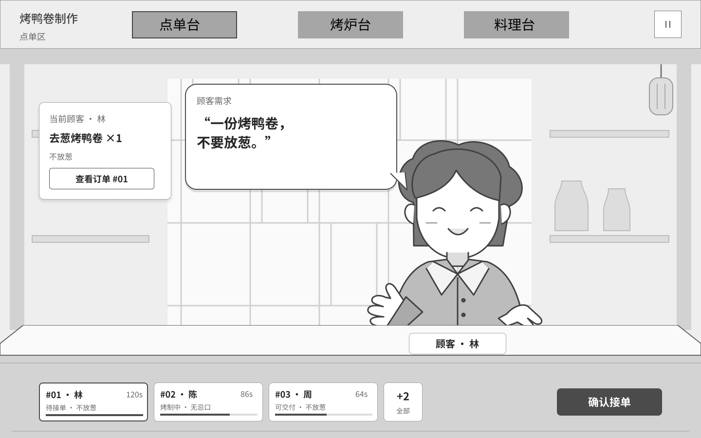

# Roast Duck Kitchen / 烤鸭小店

Take orders, watch the roast and roll each duck wrap the way the customer likes it. We’re making a 2D time-management game inspired by Papa’s Burgeria, with a warm Beijing roast-duck shop as its setting.

记住顾客的要求，照看炉里的烤鸭，再把配菜卷进饼里。我们想做一款忙碌又有烟火气的 2D 经营游戏：灵感来自《老爹汉堡店》，场景是一间暖色调的北京烤鸭小店。

## A shift in the kitchen / 小店的一轮营业

The game moves between four stations: take an order at the counter, roast the duck, assemble the wrap and serve it for a rating. Several customers may be waiting at once, so choosing what to do next matters as much as getting a single dish right. We’re exploring hand gestures for roasting and preparation, alongside mouse controls for orders.

一张订单会经过点单、烤制、料理和送餐评分四个环节。顾客不只来一位，除了把这一单做好，也要安排好下一步先忙什么。我们计划用手势完成烤制和料理操作，用鼠标管理订单。

| Station / 工作区 | What happens / 玩家做什么 |
| --- | --- |
| Order / 点单 | Read the customer’s request and accept the order / 查看顾客要求并接单 |
| Roasting / 烤制 | Control the roast with the planned gesture input / 按设计用手势操控烤制 |
| Preparation / 料理 | Finish the wrap with the requested ingredients / 按订单要求完成餐点 |
| Serving / 送餐与评分 | Deliver the dish and see the result / 把餐点交给顾客，查看评分 |

## A first look / 看看小店

These low-fidelity screens show the flow we’re building. The [design gallery](docs/design/README.md) has all four stations, the shared UI Kit and downloadable assets.

下面的低保真展示了我们正在制作的流程。[设计页面](docs/design/README.md)里可以查看四个工作区、公共 UI Kit，也可以下载图片和图标。

| Order counter / 点单台 | Preparation / 料理台 |
| --- | --- |
|  |  |

## Try the current build / 运行当前版本

Install [Godot 4.7.2 Standard](https://godotengine.org/download/archive/4.7.2-stable/), then clone or download [this repository](https://github.com/sd5913/forlives--magic_kitchen). In Godot’s Project Manager, choose **Import**, open [`game/project.godot`](game/project.godot) and click **Run Project**.

安装 [Godot 4.7.2 Standard](https://godotengine.org/download/archive/4.7.2-stable/)，克隆或下载[项目仓库](https://github.com/sd5913/forlives--magic_kitchen)。在 Godot 项目管理器中选择 **导入**，打开 [`game/project.godot`](game/project.godot)，再点击 **运行项目**。

The main branch currently opens the early workbench preview. The [order station](https://github.com/sd5913/forlives--magic_kitchen/pull/7) and [order-to-delivery prototype](https://github.com/sd5913/forlives--magic_kitchen/pull/9) are still on development branches. The preview uses a keyboard or mouse; camera controls and the final UI are being developed separately. For branch details and recorded checks, see [project status](docs/PROJECT-STATUS.md).

主分支目前打开的是早期工作台预览。[点单模块](https://github.com/sd5913/forlives--magic_kitchen/pull/7)和[接单到交付的流程原型](https://github.com/sd5913/forlives--magic_kitchen/pull/9)还在开发分支中。现有预览使用键盘或鼠标，摄像头交互和最终界面另行接入。分支情况和已有检查记录见[项目状态](docs/PROJECT-STATUS.md)。

We’re targeting Windows and macOS. The main-branch workbench preview has been checked on macOS; Windows validation of that preview is still pending. It runs without a camera or API key. Checks for the newer branch prototypes are recorded separately in [project status](docs/PROJECT-STATUS.md).

目标平台是 Windows 和 macOS。主分支的工作台预览已在 macOS 上验证，Windows 验证仍待完成；运行时不需要摄像头或 API 密钥。较新分支原型的检查记录另见[项目状态](docs/PROJECT-STATUS.md)。

## Art and interface / 美术与界面

We’ve chosen wood, parchment and brass for the shop’s interface. Shared navigation, order tickets, buttons and decorative frames live in one [Figma UI Kit](https://www.figma.com/design/OUk4C7fCqrzPmnOuzZpYGZ?node-id=148-1119), so the stations can feel like parts of the same kitchen.

我们选定了木质、羊皮纸和黄铜的界面风格。导航、订单小票、按钮和装饰边框统一放在 [Figma UI Kit](https://www.figma.com/design/OUk4C7fCqrzPmnOuzZpYGZ?node-id=148-1119) 中，让玩家切换工作区时，始终感觉自己还在同一间店里。

The [order counter high-fidelity prototype](docs/design/ORDER-STATION.md) shows compact order tracking, expandable tickets and the shared controls in context. Its Figma interactions are available to preview; the design has not yet been integrated into Godot.

[点单区高保真原型](docs/design/ORDER-STATION.md)展示紧凑订单栏、可展开小票和公共控件的组合效果，可以在 Figma 中预览交互；设计尚未接入 Godot。

[Design gallery](docs/design/README.md) · [Component guide](docs/design/UI-KIT.md) · [Shared Figma file](https://www.figma.com/design/OUk4C7fCqrzPmnOuzZpYGZ?node-id=0-1)

[设计展示](docs/design/README.md) · [组件用法](docs/design/UI-KIT.md) · [共享 Figma 文件](https://www.figma.com/design/OUk4C7fCqrzPmnOuzZpYGZ?node-id=0-1)

[High-fidelity cooking station](https://www.figma.com/design/OUk4C7fCqrzPmnOuzZpYGZ/forlives--magic_kitchen?node-id=292-7590&t=BEjKqzKKbmWPvlqU-0) / [高保真料理台](https://www.figma.com/design/OUk4C7fCqrzPmnOuzZpYGZ/forlives--magic_kitchen?node-id=292-7590&t=BEjKqzKKbmWPvlqU-0)

## Development / 开发

We use Godot and GDScript. Scenes live in `game/scenes/`, runtime art belongs in `game/assets/`, and design files and notes live in `docs/design/`. The workbench brings together four separate scenes. Game files use `snake_case`, and Godot nodes use `PascalCase`; Python development tools stay in their own directories at the repository root. The [engineering guide](docs/technical/ENGINEERING-STANDARDS.md) covers asset placement, scene ownership, Git and checks. The [technical overview](docs/technical/README.md) explains the project structure, and [CONTRIBUTING.md](CONTRIBUTING.md) explains how we work together.

我们用 Godot 和 GDScript 开发。工作台由四个独立场景组成，场景放在 `game/scenes/`，运行时素材放在 `game/assets/`，设计成果和说明放在 `docs/design/`。游戏文件用 `snake_case`，Godot 节点用 `PascalCase`，Python 开发工具放在仓库根目录的独立目录中。[工程规范](docs/technical/ENGINEERING-STANDARDS.md)说明素材归档、场景分工、Git 与检查方式，[技术总览](docs/technical/README.md)介绍工程结构，[协作说明](CONTRIBUTING.md)记录组内的开发流程。

[Project board](https://github.com/orgs/sd5913/projects/23) · [Progress](docs/WEEKLY-PROGRESS.md) · [Credits and AI assistance](CREDITS.md)

[项目看板](https://github.com/orgs/sd5913/projects/23) · [开发进度](docs/WEEKLY-PROGRESS.md) · [致谢与 AI 辅助说明](CREDITS.md)
