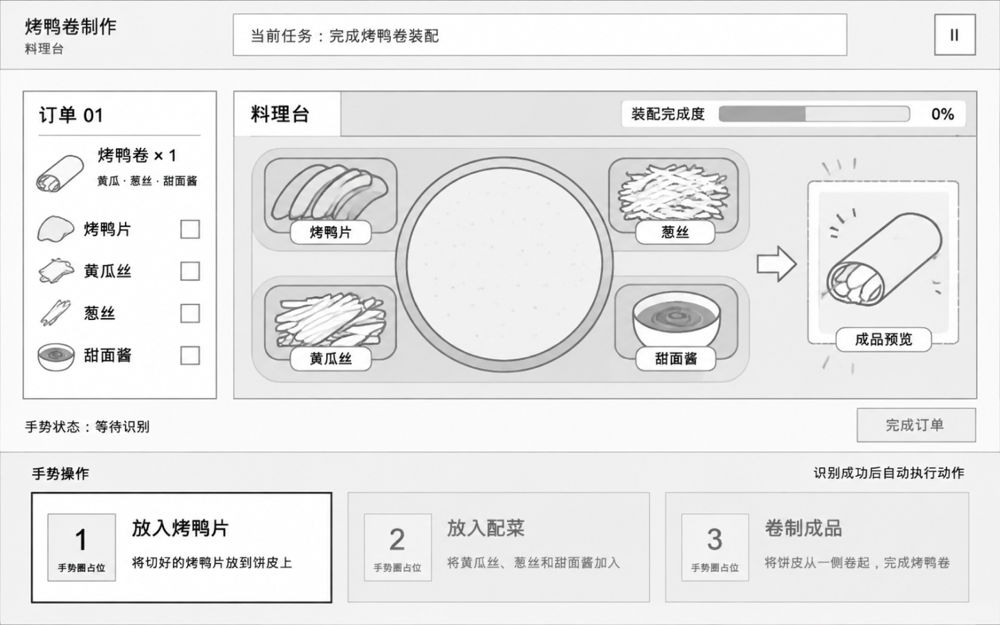
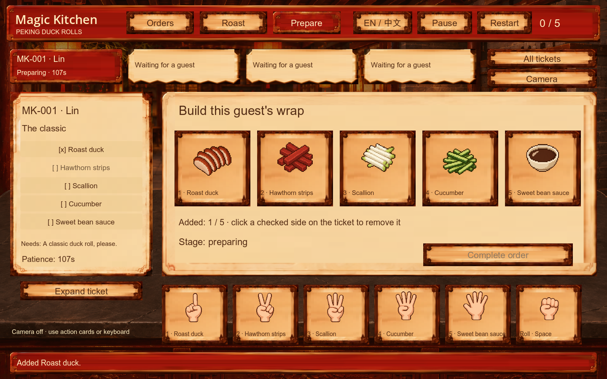
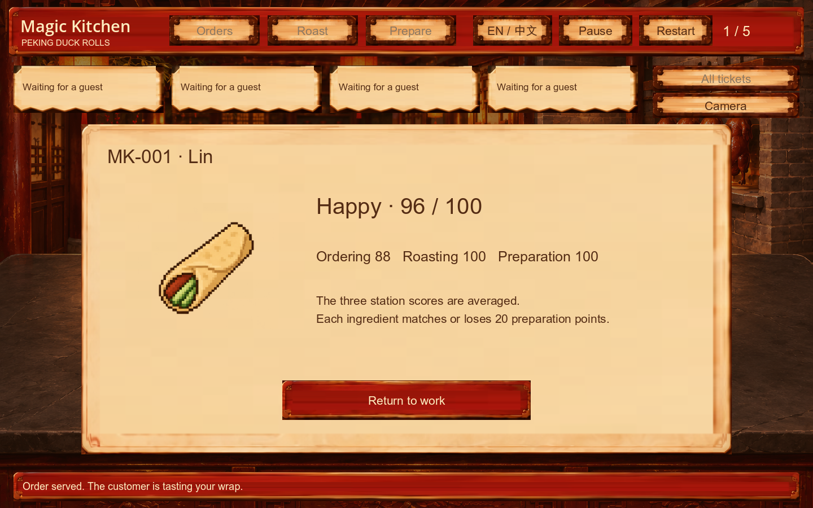

# Roast Duck Kitchen / 烤鸭小店

Take orders, watch the roast and roll each duck wrap the way the customer likes it. We’re making a 2D time-management game inspired by Papa’s Burgeria, with a warm Beijing roast-duck shop as its setting.

记住顾客的要求，照看炉里的烤鸭，再把配菜卷进饼里。我们想做一款忙碌又有烟火气的 2D 经营游戏：灵感来自《老爹汉堡店》，场景是一间暖色调的北京烤鸭小店。

We’re designing it for players who enjoy short cooking and time-management sessions. Read a customer's ticket, divide attention between stations, and use the result to improve the next wrap. Mouse and keyboard provide a complete way to play; camera gestures are an optional input under development.

我们面向喜欢短局料理和时间管理游戏的玩家：读懂顾客要求，在几个工作区之间安排顺序，再根据评分调整下一单。鼠标和键盘可以完成整轮营业，摄像头手势作为可选输入继续开发。

## A shift in the kitchen / 小店的一轮营业

The game moves between four stations: take an order at the counter, roast the duck, assemble the wrap and serve it for a rating. Several customers may be waiting at once, so choosing what to do next matters as much as getting a single dish right. We’re exploring hand gestures for roasting and preparation, alongside mouse controls for orders.

一张订单会经过点单、烤制、料理和送餐评分四个环节。顾客不只来一位，除了把这一单做好，也要安排好下一步先忙什么。我们计划用手势完成烤制和料理操作，用鼠标管理订单。

| Station / 工作区 | What happens / 玩家做什么 |
| --- | --- |
| Order / 点单 | Read the customer’s request and accept the order / 查看顾客要求并接单 |
| Roasting / 烤制 | Control the roast with the planned gesture input / 按设计用手势操控烤制 |
| Preparation / 料理 | Finish the wrap with the requested ingredients / 按订单要求完成餐点 |
| Serving / 送餐与评分 | Deliver the dish and see the result / 把餐点交给顾客，查看评分 |

## A first look / 看看小店

These low-fidelity screens show the flow we’re building. The [design gallery](docs/design/README.md) has all four stations, the shared UI Kit and downloadable assets.

下面的低保真展示了我们正在制作的流程。[设计页面](docs/design/README.md)里可以查看四个工作区、公共 UI Kit，也可以下载图片和图标。

| Order counter / 点单台 | Preparation / 料理台 |
| --- | --- |
|  |  |

## Try the current build / 运行当前版本

Install [Godot 4.7.2 Standard](https://godotengine.org/download/archive/4.7.2-stable/), then clone or download [this repository](https://github.com/sd5913/forlives--magic_kitchen). In Godot’s Project Manager, choose **Import**, open [`game/project.godot`](game/project.godot) and click **Run Project**.

安装 [Godot 4.7.2 Standard](https://godotengine.org/download/archive/4.7.2-stable/)，克隆或下载[项目仓库](https://github.com/sd5913/forlives--magic_kitchen)。在 Godot 项目管理器中选择 **导入**，打开 [`game/project.godot`](game/project.godot)，再点击 **运行项目**。

The project now opens the shared shift. Accept a ticket, use **Roast: 1 put in, 2 take out, 3 slice**, then **Prepare: 1 duck, 2 hawthorn, 3 scallion, 4 cucumber, 5 sauce; Space to roll**. Action cards also work with a mouse. Click **Complete order** to reveal the three station scores in sequence; the total and return button unlock after three seconds. Five served or expired orders finish the shift.

工程现在默认打开统一营业流程。接单后，在烤炉台按 **1 放入、2 取出、3 片鸭**；料理台按 **1 鸭肉、2 山楂、3 葱、4 黄瓜、5 酱，空格卷制**。也可点击动作卡和食材卡。完成订单后依次查看三站评分，三秒后显示总分并可返回，交付或过期共五单后结束营业。

Two oven slots and up to four active tickets share one clock. Switching stations keeps progress; **Esc** pauses, and leaving the window pauses until you resume. You can fix side ingredients before rolling. An imperfect wrap still earns a score, so mistakes become part of the shift rather than a dead end.

两个炉位和最多四张活动订单共享时间。切换保留进度，**Esc** 暂停；失焦后手动继续。卷制前可移除误加配菜，配错的卷仍可评分交付，让一次失误成为营业中的一部分。

The integrated flow has been checked on macOS with Godot 4.7.2. Windows gameplay and live-camera verification of the current integrated version remain pending. Earlier teammate feedback and two tutor showings are recorded from team recollection in the [feedback notes](docs/assessment/FEEDBACK-AND-CHANGES.md); original dates and versions still need confirmation. Keyboard and mouse need no camera or API key. Optional camera setup and the trial rule values are in the [flow guide](docs/technical/SHIFT-FLOW.md); [integration handoff](docs/technical/INTEGRATION-HANDOFF.md) lists the remaining team decisions and assets.

整合流程已在 macOS、Godot 4.7.2 下检查。当前整合版的 Windows 实机和真人相机识别仍待验证。此前同学反馈、两次 tutor 展示已根据组内回忆写入[反馈记录](docs/assessment/FEEDBACK-AND-CHANGES.md)，原日期与版本待补。键鼠运行不需要摄像头或 API 密钥。可选相机配置与试运行规则见[流程说明](docs/technical/SHIFT-FLOW.md)，待对接的决策与素材见[对接清单](docs/technical/INTEGRATION-HANDOFF.md)。

| Shared preparation / 整合料理 | Order rating / 订单评分 |
| --- | --- |
|  |  |

The playable counter now uses our approved green-clothed customer design. Tickets, confirmation, the order list and pause controls are interactive, with the same order carried into roasting and preparation.

点单台现在使用已定稿的绿衣顾客界面。小票、接单、全部订单与暂停均可操作，同一张订单会继续流转到烤炉和料理台。

The [latest cooking/serving handoff](docs/design/COOKING-HANDOFF-1125.md) includes the original asset ZIP, editable scene source, PDF and Word files, plus the implemented cooking preview.

[最新料理／交付交接](docs/design/COOKING-HANDOFF-1125.md)包含原素材 ZIP、可编辑场景源文件、PDF、Word 和已接入的料理预览。

## Art and interface / 美术与界面

We’ve chosen wood, parchment and brass for the shop’s interface. Shared navigation, order tickets, buttons and decorative frames live in one [Figma UI Kit](https://www.figma.com/design/OUk4C7fCqrzPmnOuzZpYGZ?node-id=148-1119), so the stations can feel like parts of the same kitchen.

我们选定了木质、羊皮纸和黄铜的界面风格。导航、订单小票、按钮和装饰边框统一放在 [Figma UI Kit](https://www.figma.com/design/OUk4C7fCqrzPmnOuzZpYGZ?node-id=148-1119) 中，让玩家切换工作区时，始终感觉自己还在同一间店里。

The [order counter high-fidelity prototype](docs/design/ORDER-STATION.md) shows compact order tracking, expandable tickets and the shared controls in context. Its Figma interactions remain available to preview. The playable order counter follows that design, including its ticket and pause overlays. The supplied cooking scene is now connected to shared orders, food layers and actual serving scores. Final roasting and serving artwork, plus remaining planning decisions, are still in the team handoff.

[点单区高保真原型](docs/design/ORDER-STATION.md)展示紧凑订单栏、可展开小票和公共控件的组合效果，可以在 Figma 中预览交互。可玩点单台已按这份设计接入，包含小票和暂停弹层；组员交付的料理场景也已连接共享订单、食材叠层和真实交付评分；烤炉与交付最终美术及剩余策划口径仍在对接。

[Design gallery](docs/design/README.md) · [Component guide](docs/design/UI-KIT.md) · [Shared Figma file](https://www.figma.com/design/OUk4C7fCqrzPmnOuzZpYGZ?node-id=0-1)

[设计展示](docs/design/README.md) · [组件用法](docs/design/UI-KIT.md) · [共享 Figma 文件](https://www.figma.com/design/OUk4C7fCqrzPmnOuzZpYGZ?node-id=0-1)

[High-fidelity cooking station](https://www.figma.com/design/OUk4C7fCqrzPmnOuzZpYGZ/forlives--magic_kitchen?node-id=292-7590&t=BEjKqzKKbmWPvlqU-0) / [高保真料理台](https://www.figma.com/design/OUk4C7fCqrzPmnOuzZpYGZ/forlives--magic_kitchen?node-id=292-7590&t=BEjKqzKKbmWPvlqU-0)

## Development / 开发

We use Godot and GDScript. Scenes live in `game/scenes/`, runtime art belongs in `game/assets/`, and design files and notes live in `docs/design/`. The shared shift host owns gameplay state; contributor scenes remain available for independent editing. Game files use `snake_case`, and Godot nodes use `PascalCase`; Python development tools stay in their own directories at the repository root. The [engineering guide](docs/technical/ENGINEERING-STANDARDS.md) covers asset placement, scene ownership, Git and checks. The [technical overview](docs/technical/README.md) explains the project structure, and [CONTRIBUTING.md](CONTRIBUTING.md) explains how we work together.

我们用 Godot 和 GDScript 开发。统一营业主场景管理玩法状态，各组员独立场景仍可编辑。场景放在 `game/scenes/`，运行时素材放在 `game/assets/`，设计成果和说明放在 `docs/design/`。游戏文件用 `snake_case`，Godot 节点用 `PascalCase`，Python 开发工具放在仓库根目录的独立目录中。[工程规范](docs/technical/ENGINEERING-STANDARDS.md)说明素材归档、场景分工、Git 与检查方式，[技术总览](docs/technical/README.md)介绍工程结构，[协作说明](CONTRIBUTING.md)记录组内的开发流程。

For a repeatable review package, run `python3 tools/package_review.py --godot /path/to/Godot`. It imports resources, exports a project pack, checks startup and includes run instructions and source/font notices. The result still requires Godot; it is not a standalone application or a substitute for a player trial.

需要重新生成候选试玩包时，运行 `python3 tools/package_review.py --godot /path/to/Godot`。工具会导入资源、导出并检查启动，附运行方法和来源／字体声明。结果仍需 Godot，不是独立应用，也不替代真人试玩。

[Project board](https://github.com/orgs/sd5913/projects/23) · [Progress](docs/WEEKLY-PROGRESS.md) · [Credits and AI assistance](CREDITS.md)

[项目看板](https://github.com/orgs/sd5913/projects/23) · [开发进度](docs/WEEKLY-PROGRESS.md) · [致谢与 AI 辅助说明](CREDITS.md)
