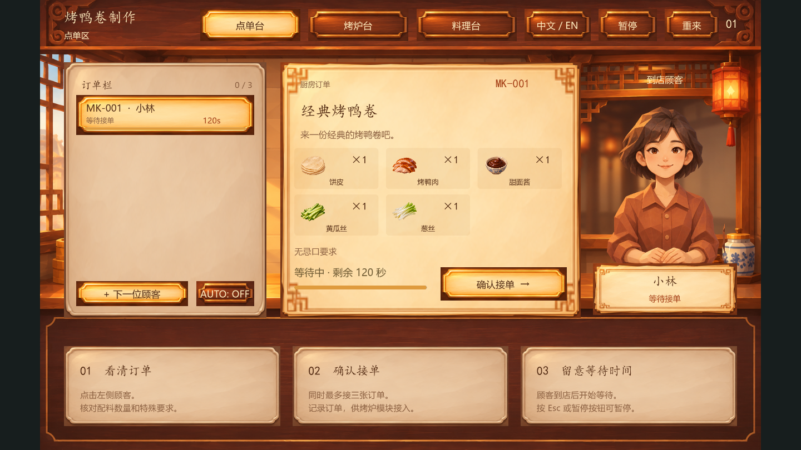

# Magic Kitchen

The current GDD v1.0 defines **Peking duck roll preparation**, a 2D time-management cooking game for Windows PC. Players take ingredient-specific orders, roast and slice duck, assemble rolls and deliver them. The earlier herbal-shop documents are historical exploration, not the current gameplay specification.

当前以 **Magic_Kitchen_GDD_v1.0** 的北京烤鸭卷制作方案为准：点单、烤鸭与片鸭、配料卷制、点击交付。目标是喜欢轻量经营、烹饪模拟和节奏管理的 Windows PC 玩家。早期药房文档作为历史探索保留，不再作为当前玩法要求。

## How a shift works / 一轮怎么玩

The complete cooking loop is not integrated yet. On `feature/order-station`, NEKO / JIN Minyi's order module supports guest arrival, recipe inspection, acceptance, parallel tickets and waiting feedback. It exposes snapshots/signals for the other stations; the preview does not simulate finished cooking or score an order.

完整烹饪流程尚未整合。`feature/order-station` 提供 NEKO / JIN Minyi 负责的点单模块：顾客到店、查看配料与特殊要求、确认接单、多订单和等待反馈。它向其他模块提供数据和信号，不把未接入的烤制、料理和评分显示成已完成。

The GDD assigns mouse input to ordering, ingredients and navigation; camera gestures belong to roasting, slicing and rolling. The order station needs no camera. See the [module guide and integration contract](docs/technical/ORDER-STATION.md).

GDD 中，鼠标负责点单、配料和导航，摄像头手势用于入炉、取出、片鸭和卷制。点单模块本身无需摄像头。[运行与接口说明](docs/technical/ORDER-STATION.md)

## Workbench preview / 工作台预览

The existing workbench is preserved. In its Orders area, click **Open order station** to open the new counter, then close it with **×** to return. The legacy mortar input check remains unchanged. The new counter uses a virtual 1440 × 900 layout scaled inside the current 960 × 540 project viewport; shared dimensions and other stations were not changed.

原工作台保留。在 Orders 区点击 **Open order station** 打开点单台，用右上角 **×** 返回。旧研钵输入检查未改。点单台按 GDD 的 1440 × 900 设计坐标缩放显示，未擅自调整项目原有 960 × 540 设置或组员其他场景。

## Run the preview / 运行预览

Install **Godot 4.7.2 Standard**, then clone or download the [repository](https://github.com/sd5913/forlives--magic_kitchen). In Godot’s Project Manager, choose **Import**, open [`game/project.godot`](game/project.godot) and click **Run Project**. [Download Godot](https://godotengine.org/download/archive/4.7.2-stable/)

安装 **Godot 4.7.2 Standard**，然后克隆或下载[项目仓库](https://github.com/sd5913/forlives--magic_kitchen)。在 Godot 项目管理器中选择 **导入**，打开 [`game/project.godot`](game/project.godot)，再点击 **运行项目**。[下载 Godot](https://godotengine.org/download/archive/4.7.2-stable/)

The earlier workbench was checked on macOS. This order-station change was checked on Windows with Godot 4.7.2 Standard, Compatibility rendering and simulated mouse/keyboard events. The preview runs locally without a camera, API key or runtime AI service. macOS checks of this new module and a packaged Windows export remain pending.

旧工作台有 macOS 检查记录；本次点单模块在 Windows、Godot 4.7.2 Standard 和 Compatibility 渲染下检查了画面及模拟鼠标/键盘操作。运行不需要摄像头、API 密钥或在线 AI 服务。新模块的 macOS 验证与 Windows 导出包仍待完成。

## Development standards / 开发规范

The Godot project lives in `game/`. The workbench assembles four separate scenes in `game/scenes/`, and Python development tools live at the repository root. We use `snake_case` for game files and `PascalCase` for Godot nodes. The engineering guide covers asset placement, scene ownership, Git and verification. [Engineering standards](docs/technical/ENGINEERING-STANDARDS.md) · [Technical overview](docs/technical/README.md)

Godot 工程放在 `game/`，工作台由 `game/scenes/` 中的四个子场景组成，Python 开发工具放在仓库根目录的独立目录中。游戏文件用 `snake_case`，Godot 节点用 `PascalCase`。素材归档、场景分工、Git 和验证流程见[工程规范](docs/technical/ENGINEERING-STANDARDS.md)与[技术总览](docs/technical/README.md)。

## Project notes / 项目资料

[Project board](https://github.com/orgs/sd5913/projects/23) · [Development progress](docs/WEEKLY-PROGRESS.md) · [Credits and AI assistance](CREDITS.md)

[项目看板](https://github.com/orgs/sd5913/projects/23) · [开发进度](docs/WEEKLY-PROGRESS.md) · [致谢与 AI 辅助说明](CREDITS.md)
