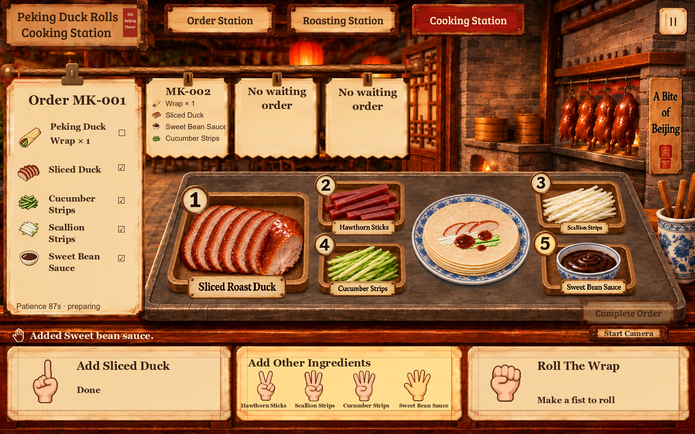
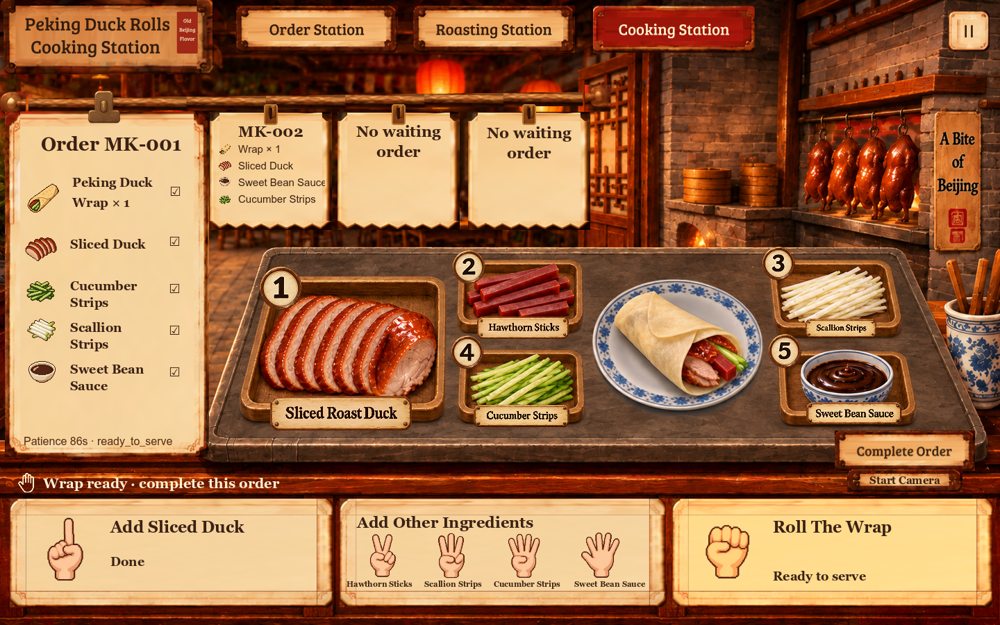

# Cooking and serving handoff / 料理与交付交接

Received from the team on 25 November; integration verified on 26 November 2026. This delivery contains the cooking asset review ZIP, the cooking/common-UI PDF, and the original serving/score DOCX. I retained the exact source files and connected the supplied cooking scene to our shared game session.

11 月 25 日收到组内料理素材审查 ZIP、料理／公共 UI PDF 和交付评分 Word，11 月 26 日完成本轮接入验证。我保留原文件，将组员交付的料理场景接到现有共享营业状态。

## Original files / 原始交付

- [Cooking assets and editable scene source](sources/handoffs_1125/cooking_station_assets_review.zip) / 料理素材和可编辑场景源文件。
- [Cooking and common-UI handoff PDF](sources/handoffs_1125/cooking_shared_ui_handoff_1123.pdf) / 料理与公共 UI 交接。
- [Serving and scoring DOCX](sources/handoffs_1125/serve_score_demo_v1_1.docx) / 交付与结算原 Word。
- [Runtime path map](preparation_handoff_manifest.json) / 原文件到运行路径的映射。

The ZIP contains 48 PNGs, its own manifest, component/control inventories and Godot scene/scripts. Every PNG matched the supplied manifest before import. Runtime copies use lowercase names under `game/assets/ui/preparation_handoff/`; original names and editable source remain inside the archived ZIP. No new artwork was generated or inferred from the screenshots.

ZIP 内有 48 张 PNG、原素材清单、组件／控件表和 Godot 场景脚本。导入前逐一核对通过原清单。运行副本按小写规范放在 `game/assets/ui/preparation_handoff/`，原名和可编辑源文件保留在 ZIP 中；本次没有新生成美术，也没有从整张截图重造界面。

## Playable integration / 可玩接入

The main entry remains `game/scenes/shift/shift_game.tscn`. Its preparation station now instantiates the contributor's layout at 1440 × 900. `shared_preparation.gd` translates UI actions and ingredient names to the existing `shift_session.gd`. The original view geometry, source textures, plate layers, hand/number indicators, header tabs and finished-wrap image are reused.

入口继续为 `game/scenes/shift/shift_game.tscn`，料理台实例化组员的 1440 × 900 场景。`shared_preparation.gd` 将控件动作和食材名称转换给既有 `shift_session.gd`，复用原布局、纹理、饼皮／食材叠层、数字手势、顶部导航和成品图。

The adapter does not copy the prototype's four sample orders or introduce a second timer. Tickets come from actual arrivals; switching returns to each real order's food. Adding and rolling obey the shared lifecycle. Clicking an added side-ingredient row removes it before rolling, including an extra ingredient not required by the recipe. Complete Order submits to the shared scoring screen rather than the supplied placeholder scene. Pausing and overlays block actions; camera counts still pass through the existing context/release gate.

适配不复制原型四张示例订单，也不另开计时。小票来自真实到达，切单恢复对应食物；加料卷制遵循共享状态。卷制前点击已加配菜行可移除，包括配方之外的误加项。完成按钮进入已有真实评分页，不跳到源包占位页。暂停／弹层会阻止操作，相机数字继续走已有工作区隔离与释放机制。

| Source item / 来源 | Current integration / 当前处理 |
| --- | --- |
| ZIP gestures / ZIP 手势 | 1 duck, 2 hawthorn, 3 scallion, 4 cucumber, 5 sauce, fist roll; matches main / 与主线一致 |
| Older PDF / 旧 PDF | Its 2 cucumber / 4 hawthorn line is superseded for this asset handoff by the newer ZIP; original retained / 本素材交付按新 ZIP，原 PDF 保留 |
| Exact-recipe prototype roll / 原型配齐卷制 | Shared game still permits an imperfect wrap with duck and scores it; planning confirmation remains open / 共享版继续允许有鸭肉的失误餐点评分，待策划统一 |
| Undo rolled food / 原型可拆卷 | Shared game locks food after rolling starts; no new post-roll undo rule / 共享版开始卷制即锁定，不新增拆卷规则 |
| Serving document / 交付方案 | Native file archived; interface/scoring comparison stays in [serving integration](../technical/SERVE-SCORE-INTEGRATION.md) / 原件归档，规则接口继续见整合说明 |
| Return and shift scope / 返回及范围 | Existing counter return / five-order shift retained pending agreement with the one-order demo / 继续当前回点单／五单流程，待统一单单 Demo |
| Language / 语言 | Supplied scene artwork and labels are English; a final localized art pass is not claimed / 交付图和标签为英文，不据此声称完成本地化美术 |

Minor integration repairs constrain long ingredient labels to two lines, keep extra-recipe rows clear of patience text, and move the camera control within its existing status strip so feedback stays readable. The original source geometry remains inspectable in the ZIP. Other contributor scenes and the approved order counter remain in place.

接入时处理长食材名换行、误加项与耐心文字间距，并在原状态条内调整相机按钮，避免挡住反馈；原几何仍可在 ZIP 中核对。其他组员独立场景与定稿点单继续保留。

## Verification / 验证

On macOS / Godot 4.7.2, the new preparation suite passed 25 behavior checks; six saved previews brought that rendered run to 31 checks with zero failures. It covers actual mouse input to add/correct, source plate layers, source number/hand highlights, real-order queue switching, station round trips, pause/lock, ready artwork, scoring and return. All nine game suites passed. These checks do not establish a new human playtest or live-camera recognition result.

macOS／Godot 4.7.2 下，新料理测试 25 项行为检查通过；六张预览保存后共 31 项、零失败。覆盖实际鼠标事件、配菜修正、叠层和数字手势反馈、真实切单、切站、暂停锁定、成品图、评分与返回；九组游戏检查通过。这不作为新增真人试玩或相机识别结果。

