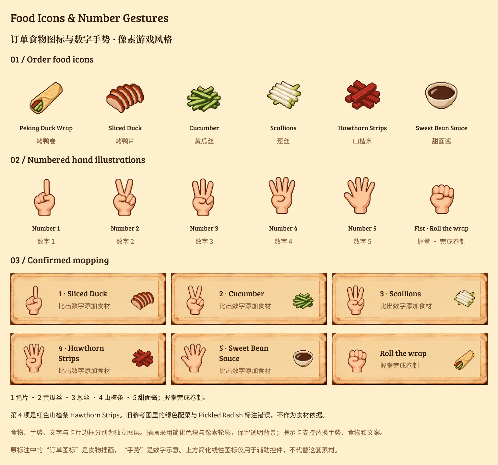

# Food icons and hand gestures / 食物图标与手势

I use the same food illustrations on the order tickets and in the preparation hints, so the player can recognise an ingredient before choosing its gesture. The numbered hands are illustrations of the input, separate from the ingredient, label and panel frame.

我把同一套食物插画用于订单小票和料理提示，让玩家先认出食材，再选择对应手势。数字手势、食物、文字与面板边框分别保留，组合时不用重新裁整张界面。

I redrew the set with warm colour blocks, clear pixel contours and simple shading. The food shapes and hands stay rounded and readable at small sizes, with fewer surface details. The same components and ingredient mapping continue to drive the ticket icons and hint-card examples.

我把这套素材重绘为暖色像素游戏插画，使用清楚轮廓、简化色块和少量明暗。食物与手形保持圆润，小尺寸下也容易辨认，并减少表面细节。小票和提示卡继续使用原来的组件与食材对应关系。

[Open the components in Figma](https://www.figma.com/design/OUk4C7fCqrzPmnOuzZpYGZ?node-id=252-2582)

[打开 Figma 组件](https://www.figma.com/design/OUk4C7fCqrzPmnOuzZpYGZ?node-id=252-2582)

## Ingredient mapping / 食材对应关系

| Gesture / 手势 | Ingredient or action / 食材或动作 |
| --- | --- |
| 1 | Sliced duck / 烤鸭片 |
| 2 | Cucumber / 黄瓜丝 |
| 3 | Scallions / 葱丝 |
| 4 | **Hawthorn strips / 山楂条** |
| 5 | Sweet bean sauce / 甜面酱 |
| Fist / 握拳 | Roll the wrap / 完成卷制 |

The fourth ingredient is red hawthorn fruit strips. The green garnish and “Pickled Radish” label in the older generated reference are mistakes. That image remains a historical visual reference, with a correction beside it in Figma; the red hawthorn component is the ingredient source to reuse.

第 4 项是红色山楂条。旧生成参考图中的绿色配菜与“Pickled Radish”标注有误。原图作为历史视觉参考保留，Figma 中已在旁边补充纠错说明；复用食材时以红色山楂条组件为准。

## Components and downloads / 组件与下载

- **Food:** `MK/Food/DuckWrap`, `SlicedDuck`, `Cucumber`, `Scallions`, `HawthornStrips`, `SweetBeanSauce`. [Six transparent PNGs](exports/food).
- **Hands:** `MK/Gesture/Number1` through `Number5`, plus `Fist`. [Six transparent PNGs](exports/gestures).
- **Hint card:** `MK/GestureHint` reuses the parchment frame. Swap the gesture and food instances, edit the label and instruction, or hide the food illustration.

- **食物：** 六个独立组件，分别对应烤鸭卷、鸭片、黄瓜丝、葱丝、山楂条和甜面酱，可下载[透明 PNG](exports/food)。
- **手势：** 数字 1—5 加握拳，共六个独立组件，可下载[透明 PNG](exports/gestures)。
- **提示卡：** `MK/GestureHint` 复用羊皮纸边框，可以替换手势和食物、修改名称与说明，也可以隐藏食物图。

Each individual PNG is 256 × 256 with an alpha channel. The illustrations are raster assets; the Figma card structure and text are editable. The [two source atlases](exports/atlases) retain the 1536 × 1024 artwork in six 512 × 512 cells. The [inventory](exports/food_gestures_manifest.json) records source nodes and the mapping.

独立 PNG 均为 256 × 256，保留透明通道。插画是位图素材，Figma 中的卡片结构与文字可编辑。[两张源图集](exports/atlases)保留 1536 × 1024 原图，每张分为六个 512 × 512 格子；[清单](exports/food_gestures_manifest.json)记录来源节点和对应关系。

The [order page](ORDER-STATION.md) now reuses these food components in its recipe rows. Order 03 includes a hawthorn-strip example. I checked the hand counts, red ingredient artwork, exported alpha channels and assembled Figma layouts. No camera recognition or Godot recipe logic was changed in this design pass.

[点单页](ORDER-STATION.md)的小票配料行已复用这套食物组件，订单 03 加入山楂条示例。我检查了手指数量、红色食材插画、导出透明通道和组合后的 Figma 布局。本次设计调整没有修改摄像头识别或 Godot 配方逻辑。

The food and hand illustrations were generated with Figma AI and organised into components with Codex assistance. This is a design asset delivery, not evidence of a player trial.

食物与手势插画使用 Figma AI 生成，由 Codex 辅助整理为组件。本次交付是设计素材，不作为玩家试玩证据。
