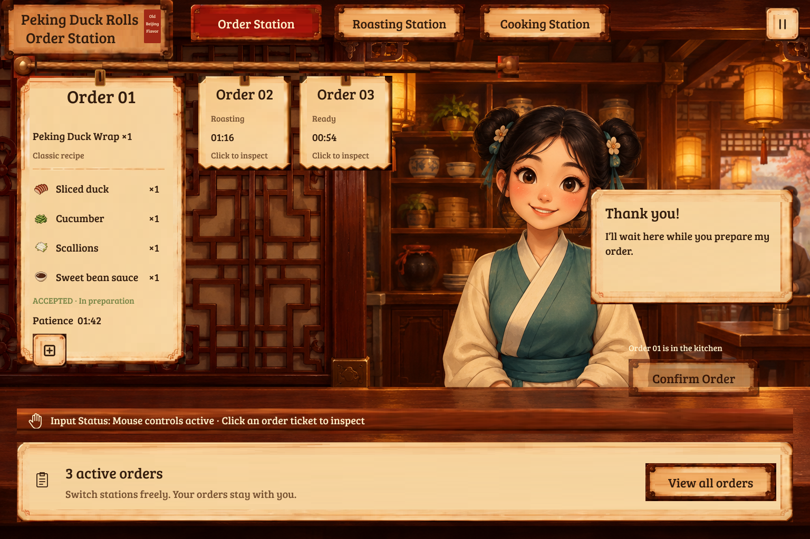
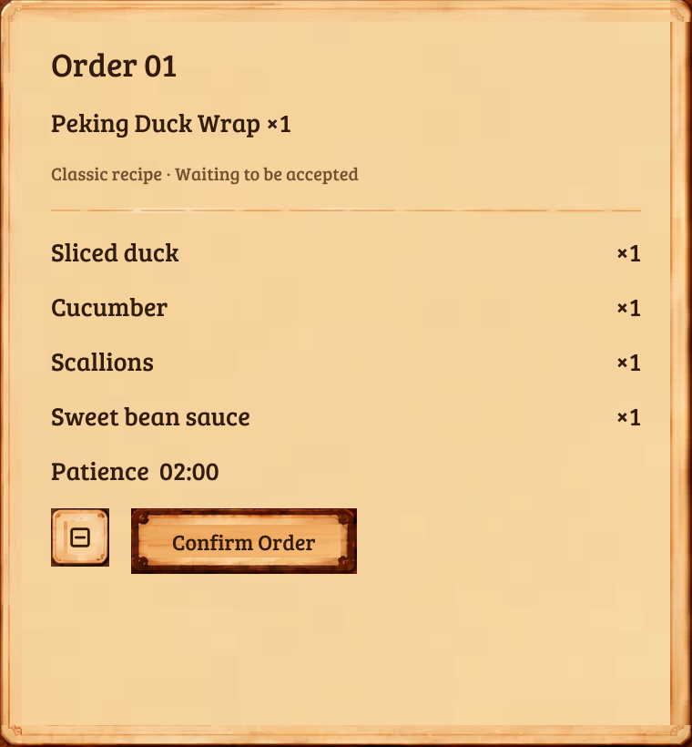
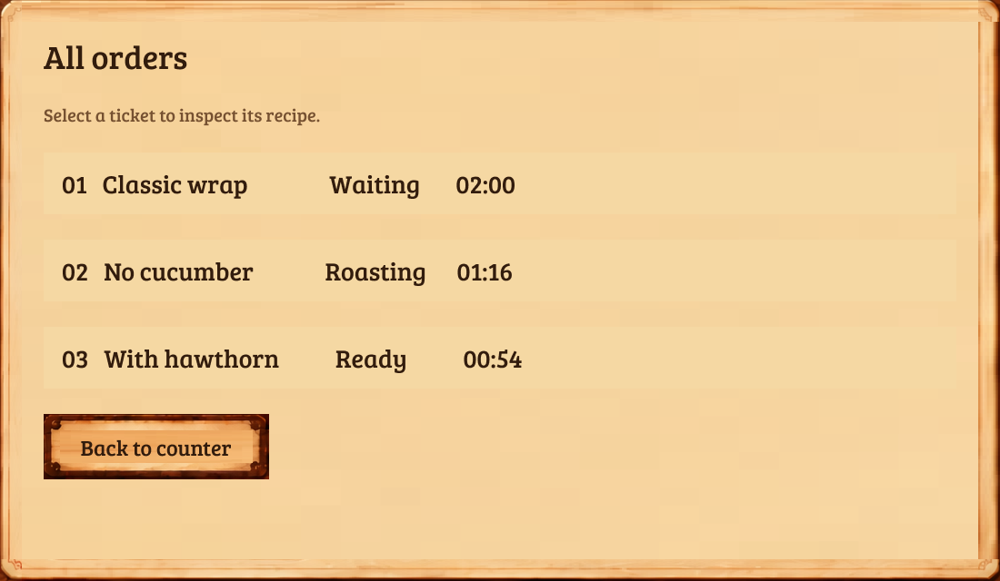
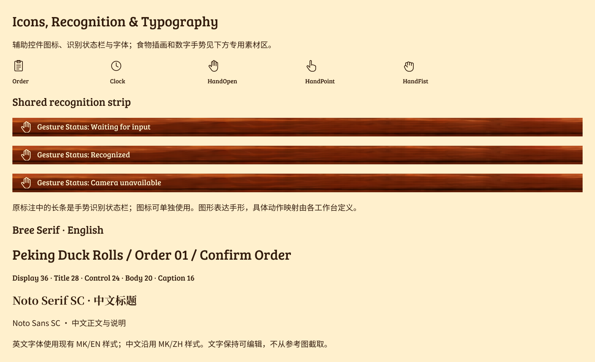

# At the counter / 在点单台前

I want the player to keep talking to the customer while checking the rest of the kitchen. The selected order opens on the left; the other tickets stay compact along the hanging rail. Accepting an order changes its status without moving the navigation or introducing a second set of controls.

我希望玩家看清顾客的要求时，也能照顾到店里的其他订单。选中的订单在左侧展开，其余小票挂在上方；确认接单后只改变订单状态，导航和操作入口保持原位。

[Open the editable page](https://www.figma.com/design/OUk4C7fCqrzPmnOuzZpYGZ?node-id=217-1122) · [Try the Figma prototype](https://www.figma.com/proto/OUk4C7fCqrzPmnOuzZpYGZ?node-id=217-1122&starting-point-node-id=217%3A1122)

[打开可编辑页面](https://www.figma.com/design/OUk4C7fCqrzPmnOuzZpYGZ?node-id=217-1122) · [打开 Figma 原型](https://www.figma.com/proto/OUk4C7fCqrzPmnOuzZpYGZ?node-id=217-1122&starting-point-node-id=217%3A1122)

## Reading and accepting an order / 查看与接单

The main ticket shows the recipe, ingredient quantities, status and remaining patience. Its expand button opens a larger, readable ticket; collapse returns to the counter. The sample orders cover a classic wrap, a wrap without cucumber and one with hawthorn strips.

主小票展示配方、配料数量、订单状态和耐心时间。展开按钮打开大号小票，收起后回到柜台。示例订单分别为经典配方、不要黄瓜和加入山楂条，方便检查不同要求能否被清楚识别。

| Accepted / 已接单 | Inspect another order / 查看其他订单 |
| --- | --- |
|  |  |

Selecting another ticket changes the details shown without accepting the waiting order. “View all orders” opens a compact list. Pause and resume are connected, and the prototype has separate ticket views before and after acceptance.

查看其他小票只切换详情，不会替玩家确认待接订单。“查看全部订单”打开紧凑列表。暂停、继续以及接单前后的订单详情也已连线。

| Expanded ticket / 展开小票 | All orders / 全部订单 |
| --- | --- |
|  |  |

## Shared with the kitchen / 与其他工作区共用

The canvas is 1536 × 1024. I used the existing `MK/Header` Order variant, ticket frames, parchment panels, buttons and icon buttons. The header keeps the same dimensions and positions as the roasting page. English uses the existing Bree Serif styles; Chinese documentation follows the kit’s Noto styles.

画布为 1536 × 1024。我使用现有 `MK/Header` 的点单状态、小票框、羊皮纸面板、按钮与图标按钮；顶栏的位置和尺寸与烘烤区一致。英文沿用 Bree Serif 样式，中文说明沿用组件库的 Noto 样式。

The kit now also includes order, clock, open-hand, pointing-hand and fist icons, plus a shared recognition strip with waiting, recognised and camera-unavailable examples. Hand shapes are reusable symbols; each station still defines its own action mapping. On the order page, the strip describes mouse input.

组件库本次补充了订单、计时、张手、指向与握拳图标，以及等待、已识别和摄像头不可用三种识别状态栏示例。手形是可复用符号，具体操作映射仍由各工作区定义；点单页的状态栏说明鼠标操作。

The recipe rows now instance the [food illustrations](FOOD-AND-GESTURES.md), with a separate icon for each ingredient. Order 03 uses red hawthorn strips. The numbered gesture set is available in the UI Kit for preparation hints; order-taking still uses the mouse.

配料行现已复用[食物插画组件](FOOD-AND-GESTURES.md)，每种食材有独立图标，订单 03 使用红色山楂条。数字手势组件放在 UI Kit 中供料理提示使用，点单仍使用鼠标操作。

## Files and current scope / 文件与当前范围

[Download the screen exports](exports/high-fi/order) · [Background illustration](exports/high-fi/order/assets/order_counter_background.png) · [SVG icons](exports/icons) · [Export inventory](exports/high-fi/order/manifest.json) · [Prototype connection record](exports/high-fi/order/prototype_connections.json)

[界面导出](exports/high-fi/order) · [场景插画](exports/high-fi/order/assets/order_counter_background.png) · [SVG 图标](exports/icons) · [导出清单](exports/high-fi/order/manifest.json) · [原型连线记录](exports/high-fi/order/prototype_connections.json)

The initial page was archived on 21 November 2026; the food-icon and hawthorn correction was archived on 22 November. Text, controls and ticket contents remain editable in Figma; PNGs are review images, and the connection record documents the links rather than recreating an interactive Figma file. The existing `.fig` backup is dated 19 November and does not include this update.

初版页面于 2026 年 11 月 21 日归档，食物图标与山楂条修正于 11 月 22 日归档。文字、控件与小票内容在 Figma 中保持可编辑；PNG 用于查看画面，连线记录用于交接，不能代替可交互的 Figma 文件。现有 `.fig` 备份保存于 11 月 19 日，不包含本次更新。

I checked rendered layouts, English font consistency, button clearance and 44 configured connections with valid destinations. The prototype uses fixed sample times and does not run gesture recognition. Station tabs open the teammate’s roasting design and preparation low-fidelity reference; those pages were not modified. Godot integration and a human playtest remain to be done.

我检查了渲染后的布局、英文字体一致性、按钮与状态栏的间距，以及 44 条已配置连线的目标。原型中的时间是固定示例，不运行手势识别。工作区标签打开组员的烘烤设计和料理台低保真参考，没有修改那些页面。接入 Godot 和真人试玩仍待完成。

The counter illustration was generated with Figma AI. UI assembly, icons, documentation and checks were assisted by Codex; details are in [credits](../../CREDITS.md).

柜台插画使用 Figma AI 生成，UI 组合、图标、文档与检查由 Codex 辅助完成，详见[致谢](../../CREDITS.md)。
