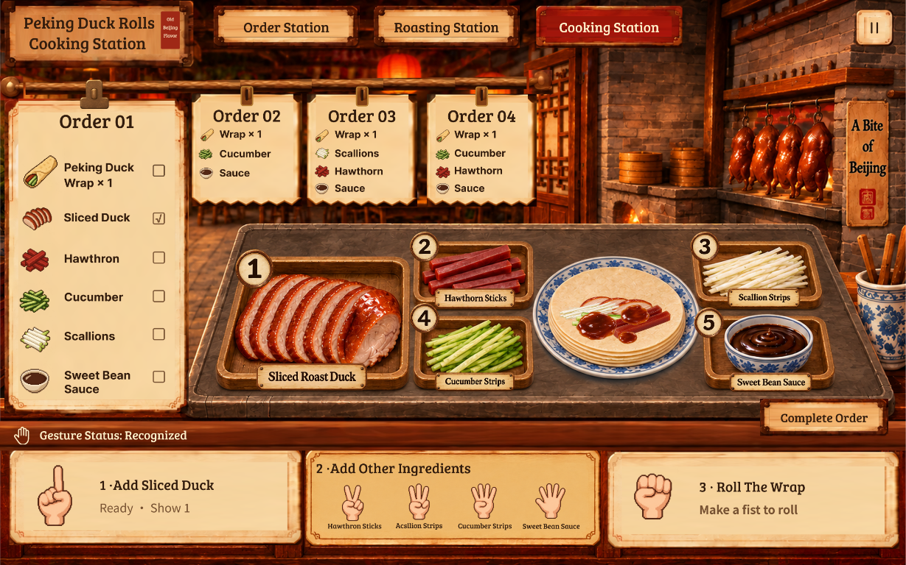
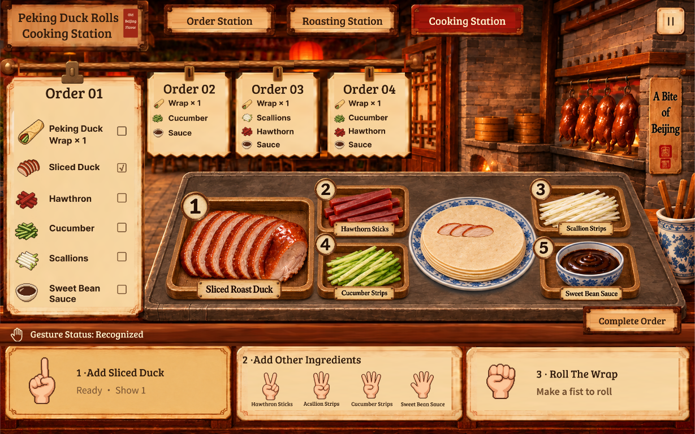
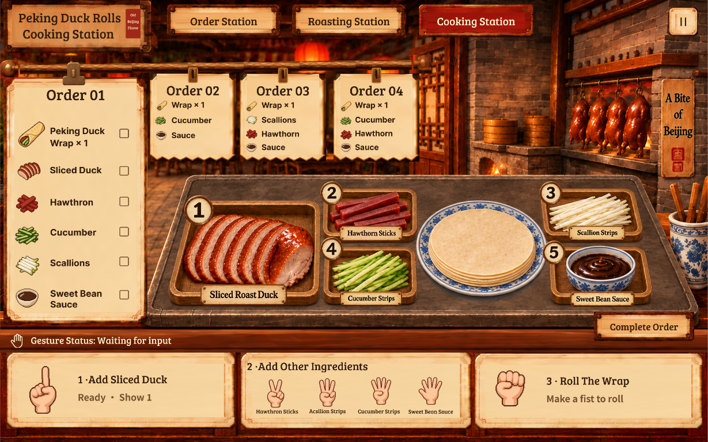
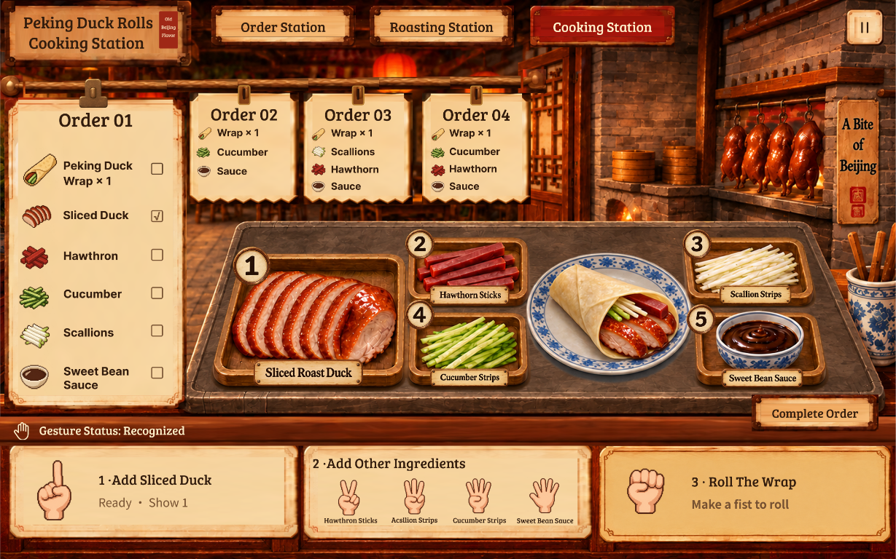
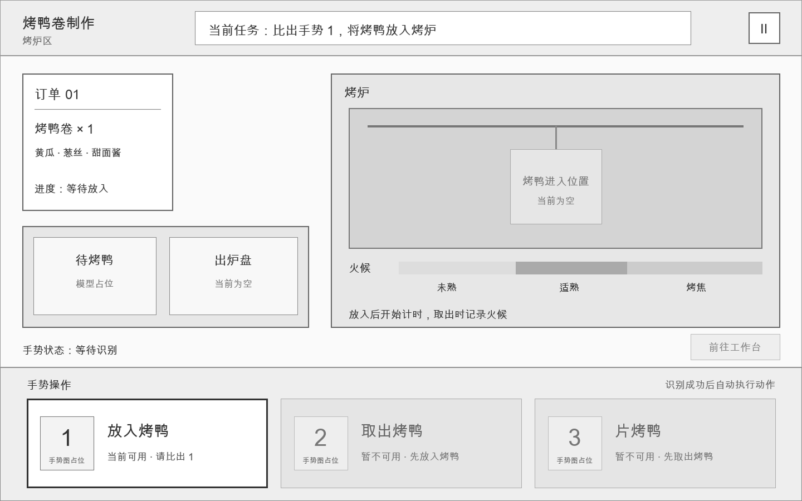
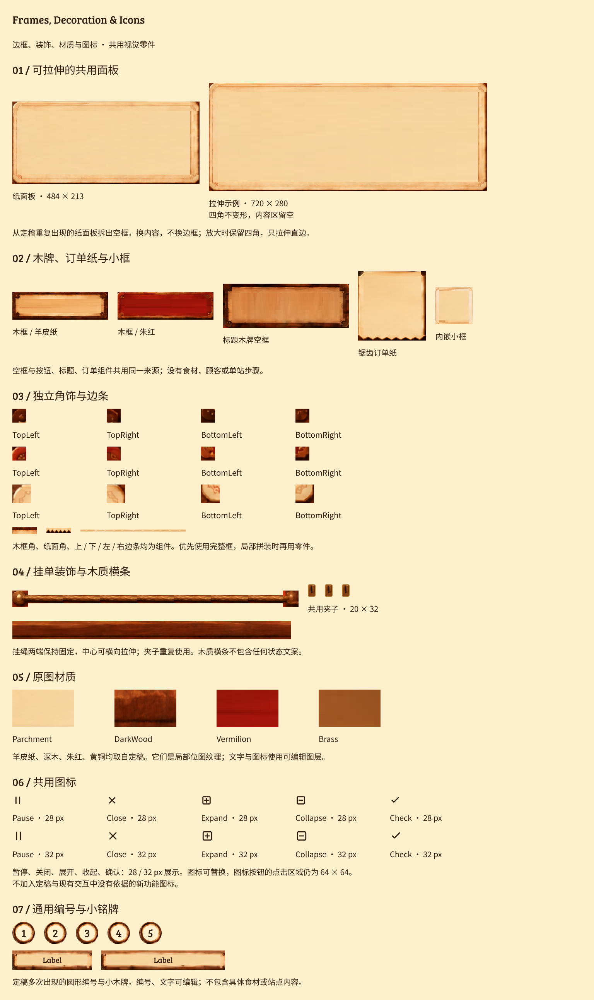

# Kitchen design / 小店的界面设计

From taking the first order to serving the finished wrap, these screens show how we want the kitchen to work. The low-fidelity flow helped us arrange the four stations; the UI Kit gives them a shared visual language.

从接下第一单，到把做好的烤鸭卷递给顾客，这些画面记录了我们对小店流程的设计。低保真先把四个工作区安排清楚，UI Kit 再把它们的视觉统一起来。

**High-fidelity cooking-station reference / 高保真料理台参考：** [Open Figma node 292-7590](https://www.figma.com/design/OUk4C7fCqrzPmnOuzZpYGZ/forlives--magic_kitchen?node-id=292-7590&t=BEjKqzKKbmWPvlqU-0)

## High-fidelity cooking steps / 高保真料理步骤

| Step 1 / 第一步 | Step 2 / 第二步 |
| --- | --- |
|  |  |

| Step 3 / 第三步 | Step 4 / 第四步 |
| --- | --- |
|  |  |

## Four stations / 四个工作区

| Order / 点单 | Roasting / 烤炉 |
| --- | --- |
|  |  |

| Preparation / 料理 | Serving and rating / 送餐评分 |
| --- | --- |
|  |  |

At the counter, the player reads the customer’s request and keeps an eye on waiting orders. The roasting station focuses on timing; preparation focuses on matching the ingredients. Serving brings the order back to the customer and shows how it went.

点单台让玩家看清顾客的要求，同时留意等待中的订单；烤炉区关注火候和时机，料理台关注配菜是否正确。最后回到顾客面前，交付餐点并查看评分。

These are design exports from 19 November 2026, rather than Godot screenshots. Order and roasting are 1440 × 900; preparation is 1458 × 912 and scoring is 1407 × 880. We kept the original sizes. The early headers also differ; the shared kit below defines the final header and navigation.

这些图片于 2026 年 11 月 19 日从 Figma 导出，不是 Godot 运行截图。点单和烤炉为 1440 × 900，料理为 1458 × 912，评分为 1407 × 880，均保留原始尺寸。早期稿的顶栏也有差异，最终顶栏与导航以接下来的公共组件为准。

## One kitchen, one interface / 同一间店，同一套界面

The shared header keeps the three station tabs and pause control in the same places. Order tickets, buttons and checkboxes follow the same rules wherever they appear.

三个工作区的切换按钮和暂停入口保持在相同的位置。订单小票、按钮和勾选框也沿用同一套规则，玩家换了工作台，就不用重新寻找操作入口。

## Frames and small details / 边框与小细节

Wooden plaques, parchment edges, hanging clips and brass details help the interface belong to the shop. We’ve separated those pieces into reusable components, with empty panels for each station’s own content.

木牌、纸边、挂单夹子和黄铜细节，让界面也像是小店里的一部分。我们把这些拆成了公共组件，面板内留出空间，供各工作区放入自己的内容。

## Files to use / 下载与使用

| Files / 文件 | What’s inside / 内容 |
| --- | --- |
| [Low-fidelity screens](exports/low-fi) | Four station PNGs / 四个工作区的低保真 |
| [UI Kit boards](exports/ui-kit) | Controls and decoration overviews / 控件与装饰总览 |
| [Component exports](exports/components) | Seven frame and component PNGs / 七张边框及组件图 |
| [Icons](exports/icons) | Five SVGs: pause, close, expand, collapse and check / 暂停、关闭、展开、收起、确认 |
| [Export manifest](exports/manifest.json) | Source nodes, dimensions, checksums and frame margins / 来源节点、尺寸、校验值与边框边距 |

| Asset / 素材 | Size / 尺寸 | Border margin / 边框边距 |
| --- | --- | --- |
| [navigation_paper_frame](exports/components/navigation_paper_frame.png) | 248 × 72 | 18 px |
| [navigation_selected_frame](exports/components/navigation_selected_frame.png) | 248 × 72 | 18 px |
| [parchment_panel](exports/components/parchment_panel.png) | 484 × 213 | 24 px |
| [inset_panel](exports/components/inset_panel.png) | 96 × 96 | 10 px |
| [order_main_frame](exports/components/order_main_frame.png) | 320 × 548 | 24 px |
| [order_mini_frame](exports/components/order_mini_frame.png) | 176 × 180 | 14 px |
| [label_plaque](exports/components/label_plaque.png) | 206 × 50 | 12 px |

The label-plaque image includes sample text. Use its Figma component when you need a different label. The other six frame images are empty; their border margins are listed in the manifest.

小铭牌图片带有示例文字，换文字时使用 Figma 中的组件。其余六张边框图片为空框，边框边距记录在清单里。

[Pause](exports/icons/pause.svg) · [Close](exports/icons/close.svg) · [Expand](exports/icons/expand.svg) · [Collapse](exports/icons/collapse.svg) · [Check](exports/icons/check.svg)

[Download the editable Figma backup](source/README.md) / [下载可编辑 Figma 备份](source/README.md)

## Keep editing / 继续设计

Open the [shared Figma file](https://www.figma.com/design/OUk4C7fCqrzPmnOuzZpYGZ?node-id=0-1) to edit the layouts, or go straight to the [UI Kit](https://www.figma.com/design/OUk4C7fCqrzPmnOuzZpYGZ?node-id=148-1119) for components and variants. The [component guide](UI-KIT.md) explains what stays shared and how to resize the frames.

继续调整布局时，打开[共享 Figma 文件](https://www.figma.com/design/OUk4C7fCqrzPmnOuzZpYGZ?node-id=0-1)；使用主组件和变体时，可以直接进入 [UI Kit](https://www.figma.com/design/OUk4C7fCqrzPmnOuzZpYGZ?node-id=148-1119)。哪些部分共用、边框怎样拉伸，见[组件用法](UI-KIT.md)。

These exports show the design at this point in development. The final appearance still needs to be brought into Godot. Asset sources and AI assistance are recorded in [credits](../../CREDITS.md).

这些导出文件保存了当前阶段的设计，最终视觉还需要接入 Godot。素材来源和 AI 辅助范围见[致谢说明](../../CREDITS.md)。
