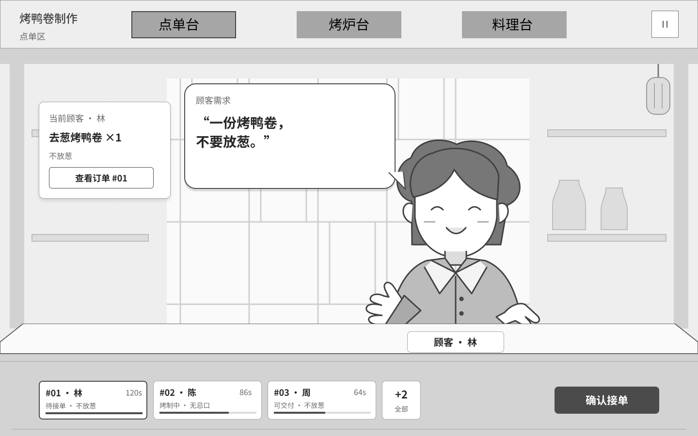
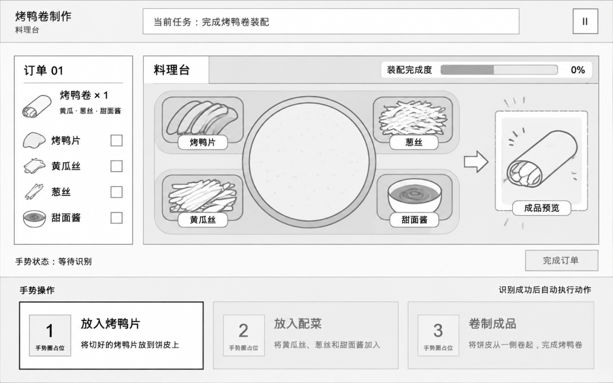
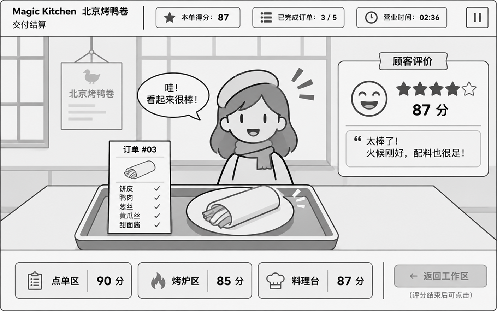
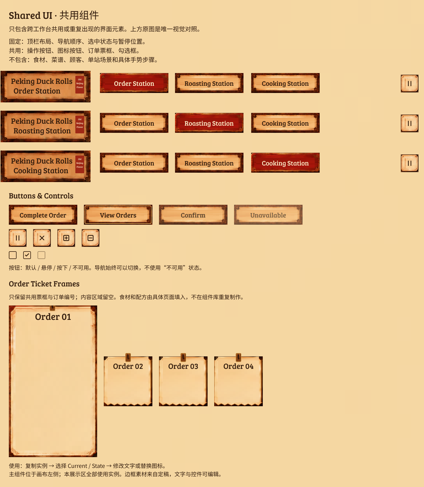

# Design review archive / 设计成果审查

Exported from our [shared Figma file](https://www.figma.com/design/OUk4C7fCqrzPmnOuzZpYGZ?node-id=0-1) on **19 November 2026, Hong Kong time**. I selected and inspected one representative low-fidelity screen in each named station area, then archived the shared UI Kit boards, frame exports and SVG icons. Teammates' source pages and earlier variants remain in Figma.

本页成果于 **2026 年 11 月 19 日（香港时间）**从[共享 Figma 文件](https://www.figma.com/design/OUk4C7fCqrzPmnOuzZpYGZ?node-id=0-1)导出。我按四个工作区分别选取并查看一张代表性低保真，再归档公共 UI Kit 展示板、边框导出和 SVG 图标。组员源页面与早期版本保留在 Figma。

## Review contents / 本次提交清单

| Delivery / 成果 | Files / 文件 |
| --- | --- |
| Low-fidelity screens / 低保真 | 4 PNG: Order, Roasting, Preparation, Scoring / 点单、烤炉、料理、评分 |
| Shared UI boards / 公共组件展示 | 2 PNG: Controls overview; Frames, decoration and icons / 控件总览、边框装饰与图标 |
| Individual component exports / 独立组件导出 | 7 PNG: two navigation frames, parchment/inset panels, main/mini order frames and a label-plaque specimen / 两种导航框、纸面板、内嵌框、大小订单框和小铭牌展示 |
| Vector icons / 矢量图标 | 5 SVG: Pause, Close, Expand, Collapse, Check / 暂停、关闭、展开、收起、确认 |
| Source index / 来源索引 | [Manifest](exports/manifest.json): node IDs, original dimensions, SHA-256 checksums and frame margins / 节点、原始尺寸、校验值及边框边距 |

## Low-fidelity flow / 低保真流程

| Order / 点单 | Roasting / 烤炉 |
| --- | --- |
|  |  |

| Preparation / 料理 | Scoring / 评分 |
| --- | --- |
|  |  |

These are original-size design exports, not Godot screenshots. Preparation is 1458 × 912 and scoring is 1407 × 880; I kept those sizes rather than stretching them to match the two 1440 × 900 exports. Their historical headers differ. The common final header is specified in the UI Kit.

以上保留原始尺寸，不是 Godot 运行截图。料理稿为 1458 × 912，评分稿为 1407 × 880，没有强行拉伸成另外两张的 1440 × 900。历史低保真的顶栏尚有差异；最终公共顶栏以 UI Kit 为准。

## Shared controls / 公共控件

## Frames, decoration and icons / 边框、装饰与图标

## Individual exports / 独立导出文件

| Asset / 素材 | Size / 尺寸 | Border margin / 边框边距 |
| --- | --- | --- |
| [navigation_paper_frame](exports/components/navigation_paper_frame.png) | 248 × 72 | 18 px |
| [navigation_selected_frame](exports/components/navigation_selected_frame.png) | 248 × 72 | 18 px |
| [parchment_panel](exports/components/parchment_panel.png) | 484 × 213 | 24 px |
| [inset_panel](exports/components/inset_panel.png) | 96 × 96 | 10 px |
| [order_main_frame](exports/components/order_main_frame.png) | 320 × 548 | 24 px |
| [order_mini_frame](exports/components/order_mini_frame.png) | 176 × 180 | 14 px |
| [label_plaque](exports/components/label_plaque.png) | 206 × 50 | 12 px |

The small label-plaque PNG is a component specimen with its editable Figma label rendered into the image. Do not use it as a blank runtime texture. The other six frame PNGs contain the empty frames. Their margins are recorded for later nine-slice integration.

小铭牌 PNG 是组件展示图，Figma 中的可编辑文字已随图片渲染，不应直接当作空白运行时纹理。其余六张为无内容边框，已记录后续九宫格接入所需的边距。

[pause](exports/icons/pause.svg) · [close](exports/icons/close.svg) · [expand](exports/icons/expand.svg) · [collapse](exports/icons/collapse.svg) · [check](exports/icons/check.svg)

## Source and implementation / 源文件与接入

The exports make the work visible and downloadable in GitHub. Editable main components, variants, properties and prototype connections remain in Figma; PNG/SVG snapshots do not preserve that full behaviour. This archive is not an editable `.fig` backup or a finished Godot integration.

这些文件让成果能直接在 GitHub 查看、下载。可编辑主组件、变体、属性和原型连线仍保留在 Figma，PNG/SVG 导出不保留全部行为。本归档不是可编辑 `.fig` 备份，也不代表 Godot 已接入完成。

See [UI Kit rules and handoff](UI-KIT.md), [weekly progress](../WEEKLY-PROGRESS.md) and [credits](../../CREDITS.md). The manifest records node-level sources; original illustration authorship and runtime redistribution details remain to be recorded before game-asset publication.

组件规则和接入见[UI Kit 交接](UI-KIT.md)，过程见[周进度](../WEEKLY-PROGRESS.md)，来源说明见[致谢](../../CREDITS.md)。清单记录到 Figma 节点；原始插画作者与运行时再分发信息仍需在游戏素材发布前补齐。
