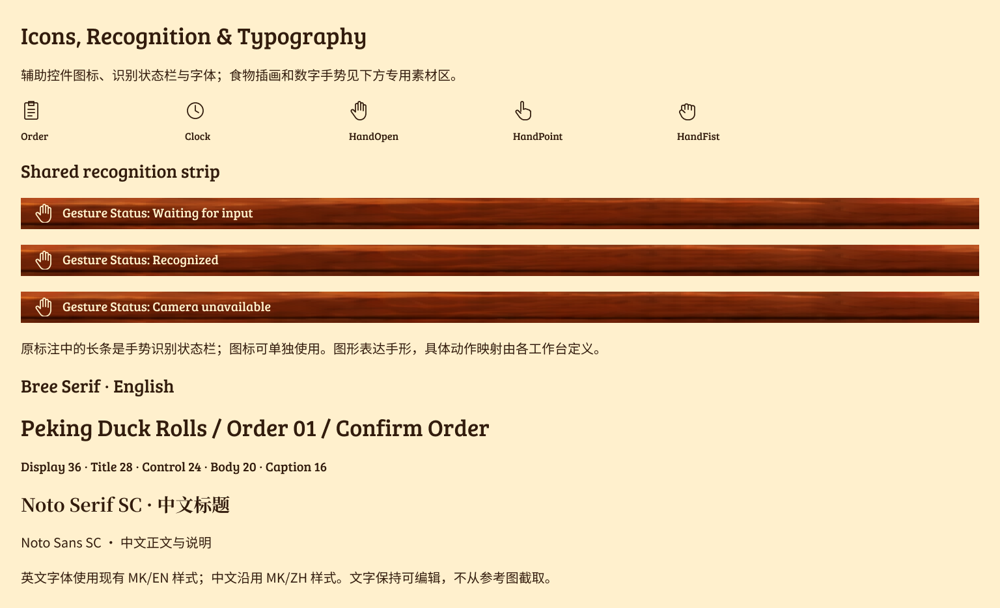
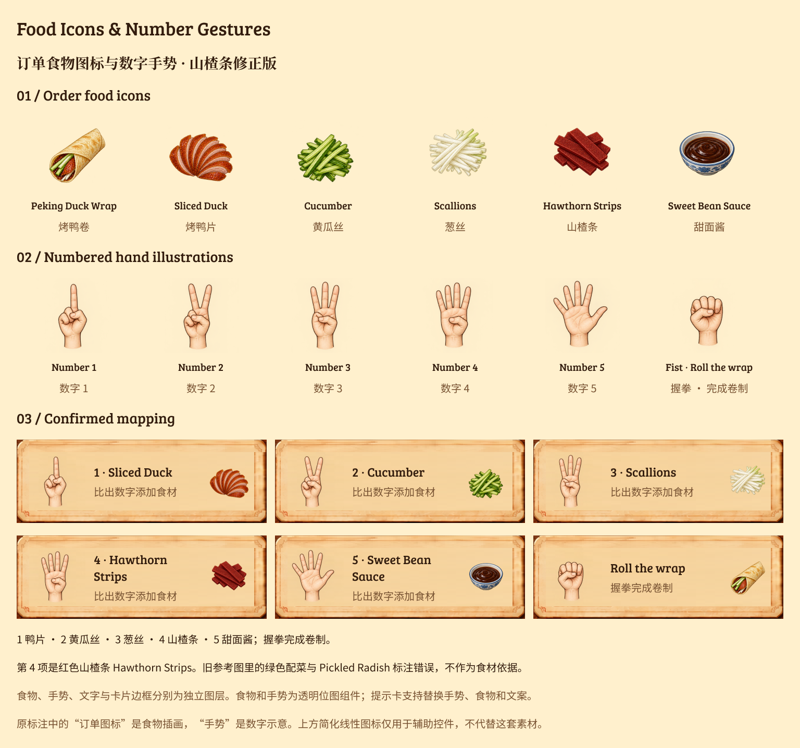

# Shared UI Kit / 公共 UI 组件

I built this kit so the team can work on different stations without drawing a different interface for each one. The header, controls and frames stay familiar; the customer, food and task inside each station can change.

我整理这套组件，是为了让大家分头制作工作区时，还能保持同一套界面。顶栏、控件和边框保持一致，顾客、食材和具体任务则由各工作区自己处理。

[Open the UI Kit in Figma](https://www.figma.com/design/OUk4C7fCqrzPmnOuzZpYGZ?node-id=148-1119) · [Browse the exported designs](README.md)

[打开 Figma 组件页](https://www.figma.com/design/OUk4C7fCqrzPmnOuzZpYGZ?node-id=148-1119) · [查看导出设计](README.md)

Updated 22 November 2026. / 更新于 2026 年 11 月 22 日。

## The visual starting point / 视觉基准

We’re using the [selected cooking-station image](https://www.figma.com/design/OUk4C7fCqrzPmnOuzZpYGZ?node-id=131-1686) as the reference: warm wood, parchment and brass, on a 1536 × 1024 canvas. A copy sits at the top of the UI Kit page for comparison. Earlier low-poly explorations remain in the design file.

我们以[选定的料理台原图](https://www.figma.com/design/OUk4C7fCqrzPmnOuzZpYGZ?node-id=131-1686)为基准：暖色木质、羊皮纸和黄铜，画布为 1536 × 1024。组件页最上方放了一份原图，方便制作时对照；早期 low-poly 探索仍保留在设计文件里。

## What to reuse / 可以直接复用什么

| Component / 组件 | Use / 用途 |
| --- | --- |
| Header and station tabs / 顶栏与导航 | Switch between Order, Roasting and Cooking; keep pause in the same place / 切换点单、烤制和料理，暂停入口位置固定 |
| Buttons and checkboxes / 按钮与勾选框 | Reuse the default, hover, pressed and disabled states where appropriate / 根据操作复用默认、悬停、按下和不可用状态 |
| Order tickets / 订单小票 | Main and compact frames with editable order numbers / 大小票框，订单编号可修改 |
| Panels and frame parts / 面板与边框零件 | Wood plaques, parchment panels, inset frames, scalloped paper, corners and edges / 木牌、纸面板、内嵌框、锯齿纸、角饰和边条 |
| Decorations / 装饰 | Hanging rope, clips, wood strips, dividers, number badges and small labels / 挂单绳、夹子、木条、分隔线、编号与小铭牌 |
| Foundations / 基础样式 | Shared colour and spacing variables, typography styles and editable component properties / 共用颜色、间距变量、文字样式与可编辑组件属性 |
| Materials and icons / 材质与图标 | Parchment, wood, red and brass; pause, close, expand, collapse and check / 纸面、木质、朱红、黄铜，以及暂停、关闭、展开、收起和确认图标 |

The [controls board](https://www.figma.com/design/OUk4C7fCqrzPmnOuzZpYGZ?node-id=159-1459) shows the shared interface in use. The [decoration board](https://www.figma.com/design/OUk4C7fCqrzPmnOuzZpYGZ?node-id=178-2243) shows frames, materials and small parts separately.

[控件展示板](https://www.figma.com/design/OUk4C7fCqrzPmnOuzZpYGZ?node-id=159-1459)展示公共界面的组合效果，[装饰展示板](https://www.figma.com/design/OUk4C7fCqrzPmnOuzZpYGZ?node-id=178-2243)则把边框、材质和小零件单独列出。

## Icons, recognition and type / 图标、识别与字体

The [supplementary board](https://www.figma.com/design/OUk4C7fCqrzPmnOuzZpYGZ?node-id=215-2530) adds `MK/Icon/Order`, `Clock`, `HandOpen`, `HandPoint` and `HandFist`, with editable SVG exports. `MK/RecognitionStatus` provides Waiting, Recognized and Unavailable variants with an editable label. Reuse the hand symbols across stations; station-specific gesture mappings stay outside the kit.

[补充展示板](https://www.figma.com/design/OUk4C7fCqrzPmnOuzZpYGZ?node-id=215-2530)新增 `MK/Icon/Order`、`Clock`、`HandOpen`、`HandPoint` 和 `HandFist`，并提供可编辑 SVG。`MK/RecognitionStatus` 包含 Waiting、Recognized、Unavailable 三种状态，文案可修改。手形符号供多个工作区复用，具体动作映射仍由各工作区定义。

English uses Bree Serif at 36 / 28 / 24 / 20 / 16 px for display, title, control, body and caption. Chinese uses the existing Noto Serif SC title and Noto Sans SC body styles. These font examples make the existing styles easier to find; they do not replace teammate text layers.

英文使用 Bree Serif，展示、标题、控件、正文和辅助文字分别为 36 / 28 / 24 / 20 / 16 px。中文沿用 Noto Serif SC 标题和 Noto Sans SC 正文样式。字体样张用于帮助查找现有样式，没有替换组员页面中的文字图层。

## Food and numbered gestures / 食物与数字手势

The [food and gesture board](FOOD-AND-GESTURES.md) supplies six food illustrations, hands for 1–5 and a fist, and a reusable hint card with swap properties. The earlier clipboard and simplified hand outlines are auxiliary control icons; they do not fulfil the food-icon and numbered-gesture annotations.

[食物与手势展示板](FOOD-AND-GESTURES.md)提供六种食物插画、数字 1—5 与握拳，以及支持替换素材的提示卡。之前的夹板和简化手形是辅助控件图标，不能代替标注所指的食物图标和数字手势。

Use **4 → Hawthorn Strips / 山楂条**. The red hawthorn illustration replaces the mistakenly generated green garnish; the older reference image is annotated rather than silently treated as correct. Individual PNGs retain transparent backgrounds.

第 **4 项对应山楂条**，使用红色山楂插画。旧参考图里错误生成的绿色配菜已加纠错说明，不再当作正确食材；独立 PNG 保留透明背景。

## Using the components / 怎么使用

1. Copy an instance and change its label, number, icon or state in the properties panel.
2. Keep station tabs available. Accepting an order should not unlock navigation.
3. Put station-specific content into the empty panels, and keep the same order identity when switching stations.
4. Resize frames by stretching the straight edges and centre. Keep the corners at their original size.

1. 复制组件实例，在属性面板中修改文字、编号、图标或状态。
2. 工作区始终可以切换，不把接单作为导航的解锁条件。
3. 把工作区自己的内容放进空面板，切换时继续使用同一张订单。
4. 拉伸边框时只调整直边和中间区域，四角保留原尺寸。

The icon examples are 28 and 32 px; their buttons use a 64 × 64 hit area. Decorative textures come from cropped parts of the reference image. Text and vector icons remain editable.

图标展示了 28、32 px 两种大小，对应按钮保留 64 × 64 的点击区。装饰纹理来自原图局部，文字和矢量图标保持可编辑。

Food illustrations and numbered hand assets now have their own reusable section. Recipes, customers, station scenes and the timing of gesture actions remain station content.

食物插画和数字手势素材已独立收录为可复用组件；配方、顾客、工作区场景以及手势动作的执行时机仍由各工作区处理。

## Checked in Figma / 已检查的部分

I checked the assembled boards, corrected text left in the cropped textures and fixed wrapping and alignment. The three header states use identical positions and sizes. In the resize example, a paper panel grows from 484 × 213 to 720 × 280 while its four corners stay 24 × 24.

我检查了组合后的展示板，清理取材中残留的文字，调整了换行和对齐。三种顶栏状态的位置与尺寸一致；纸面板从 484 × 213 放大到 720 × 280 时，四角仍保持 24 × 24。

## Bringing it into Godot / 接入 Godot

The low-fidelity flow and shared kit are ready for the next stage. I’ll start with the common header, controls and panel frames, then connect them to the existing order state. Runtime exports go in `game/assets/ui/`, using the repository’s `snake_case` names. Use `StyleBoxTexture` or `NinePatchRect` for frames, with the [recorded border margins](exports/manifest.json).

低保真流程和公共组件已整理好。下一步，我先接入公共顶栏、控件和面板边框，再连接现有订单状态。运行时素材放入 `game/assets/ui/`，沿用仓库的 `snake_case` 命名。边框使用 `StyleBoxTexture` 或 `NinePatchRect`，边距参考[导出清单](exports/manifest.json)。

There is one layout decision to resolve first: the new design is 1536 × 1024, the main scaffold is 960 × 540, and the earlier ordering layout is 1440 × 900. I’ll settle scaling and safe areas in the shared host before changing individual scenes.

接入前还要统一尺寸：新设计为 1536 × 1024，主分支基础视口为 960 × 540，早期点单布局为 1440 × 900。我会先在公共主场景中处理缩放与安全区域，再调整各个场景。

Godot integration and a player trial are still ahead. The Figma checks above cover the design; they do not establish how the finished game feels to play. Branch progress is kept in [project status](../PROJECT-STATUS.md), and asset sources are kept in [credits](../../CREDITS.md).

Godot 接入和玩家试玩是后续工作。上面的检查针对设计本身，还不能说明完整游戏玩起来的感受。分支进度见[项目状态](../PROJECT-STATUS.md)，素材来源见[致谢](../../CREDITS.md)。
