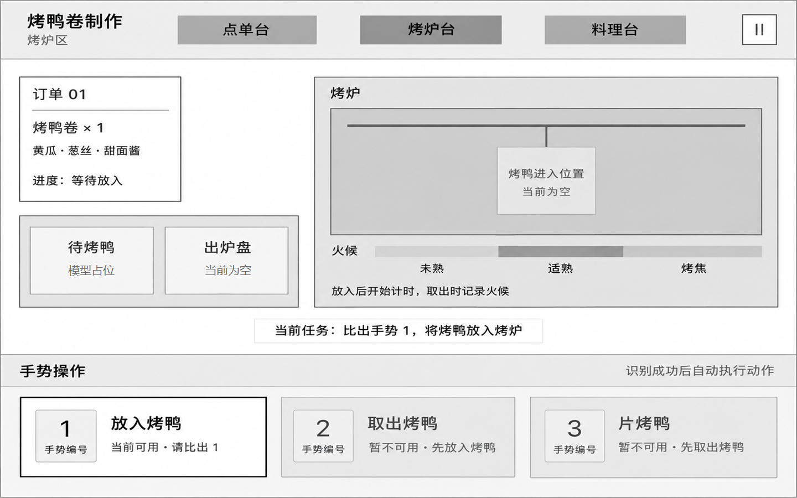
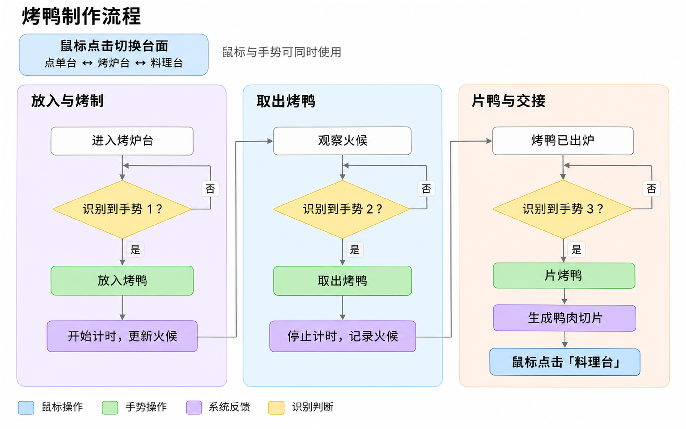

# Roasting Station Design / 烤炉区设计

## Wireframe / 低保真界面

The roasting station wireframe shows the current order, the oven, a doneness indicator, and three gesture prompts. Players click the tabs at the top to switch between the Order, Roasting, and Assembly stations. The mouse and gesture controls can be used at the same time.

烤炉区低保真图展示了当前订单、烤炉、火候指示和三张手势提示卡。玩家可以用鼠标点击顶部入口，在点单台、烤炉台和料理台之间切换。鼠标和手势可以同时使用。

## Interaction Flow / 操作流程

The flowchart shows how the roasting station responds to each gesture. Gesture 1 puts the duck in the oven and starts the timer. Gesture 2 takes the duck out and records its doneness. Gesture 3 slices the duck. Once the duck is sliced, the player clicks the Assembly tab to continue making the wrap.

流程图展示了烤炉区识别到各个手势后的反馈。手势 1 将鸭子放入烤炉并开始计时，手势 2 取出烤鸭并记录火候，手势 3 完成片鸭。片鸭完成后，玩家用鼠标点击「料理台」，继续制作烤鸭卷。

