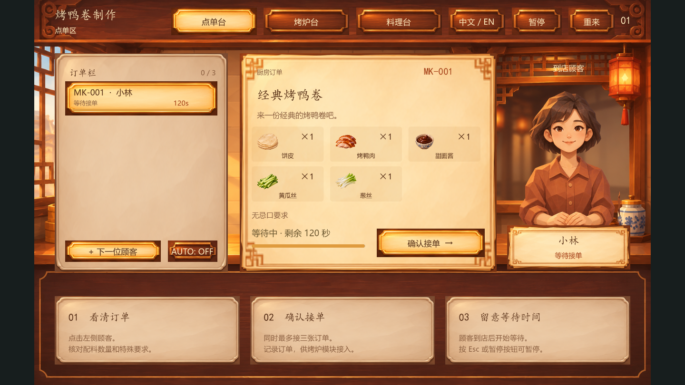

# NEKO's order station / 点单模块

Owner: JIN Minyi / IceyHikari, identified as NEKO by the user on 14 November 2026. Branch: `feature/order-station`. Baseline: `973f8e3`. This module follows the supplied GDD v1.0 for Peking duck rolls; it does not implement the historical herbal-shop proposal.

## Design source and boundaries

The user supplied `Magic_Kitchen_GDD_v1.0.docx`, SHA-256 `5410e711b0ddeb42da67b04308c75ffc4c65514f454c92b0bd682d9b1ad1b782`. The WPS cloud version could not be read, so identity with the current cloud copy is unverified. The Figma connector denied access. The user then supplied a warm, low-poly/faceted restaurant rendering as the style reference. Generated runtime art follows that direction; visual-owner review remains pending.

The GDD assigns this station to showing customers, creating a standard order object, accepting orders and making priorities readable. Cooking, gesture recognition and scoring belong to other modules. Navigation to Roast/Prepare in this isolated preview explains that integration is pending; it does not advance a ticket or pretend to cook.

## Run

Use Godot 4.7.2 Standard and Compatibility rendering. Open `game/project.godot`, run the project, and click **Open order station** inside the Orders panel. Use **×** to return. Existing mortar and other workbench subscenes remain unchanged.

For direct testing, open [order_station.tscn](../../game/scenes/orders/order_station.tscn) in the editor and press F6. Or from the repository root, with Godot on PATH:

```sh
godot --path game res://scenes/orders/order_station.tscn
```

On Windows, replace `godot` with the installed executable's full path. The implementation does not require Python packages, a webcam, an API key or a live service.

## What to try

1. Read the first guest's recipe, ingredient quantities and exclusions. Click **Accept order** once.
2. Use **Next guest** and accept more orders. The fourth guest remains pending when three kitchen orders are active. Switching tickets does not alter their requirements.
3. Switch between English and Chinese; the same ticket IDs and states remain.
4. Pause with the button or Esc. Resume to continue waiting. Focus loss also stops the isolated preview's clock. English is the default for final presentation; Chinese remains an optional toggle. Language selection is not persisted across fresh sessions.
5. Let a customer expire; the live queue releases that slot. Restart asks for confirmation, and cancel preserves the queue.
6. Use Tab to focus a button and Enter/Space to activate it. AUTO toggles an optional 18-second arrival attempt; it never overwrites a waiting guest.

Capacity (three active plus one pending), four sample recipes, patience values (100–130 seconds) and the optional arrival interval are **demo tuning choices**, not fixed GDD requirements. Recipe data uses the GDD ingredient pool, including cucumber, scallion, sauce, sugar, melon and hawthorn. Negative preferences are encoded as exclusions, not medical allergy guarantees.

## Layout and art

The station uses a 1440 × 900 virtual canvas: 100px header, 560px main region, 240px instruction region. It letterboxes/scales inside the existing 960 × 540 project viewport rather than editing shared project dimensions. The order station uses the bottom region for non-gesture instructions, as the GDD permits. Raster background/portraits and nine-slice panel textures establish the restaurant style; text, selection, counts, timers and controls remain live.



[Rendered English station](../images/order_station_english.png). These are actual Godot render captures, not Figma exports or generated interface screenshots.

## Integration contract

Files:

- [order_manager.gd](../../game/scenes/orders/order_manager.gd): isolated state model, no UI or camera dependencies.
- [order_station.gd](../../game/scenes/orders/order_station.gd): view and inputs.
- [order_recipes.json](../../game/data/order_recipes.json): ingredient labels, recipes and fictional customer profiles.
- [order_panel.gd](../../game/scenes/order_panel.gd): opens the station over the legacy scaffold without moving other zones.

`DuckOrderManager` is a Node, not an autoload. The standalone station creates and advances its own instance. For integration, the main game should own **one** shared manager and its clock, assign `station.manager = shared_manager` **before** adding the station to the tree, and connect its signals. The station does not advance an injected manager. Handle `pause_requested(is_paused)` and `restart_requested` at the host; a component cannot silently reset the host's orders. Closing/hiding the isolated preview freezes its local clock, which is a preview behaviour, not the intended cross-station game clock.

Public manager API:

```gdscript
var order = shared_manager.create_order() # optional recipe_id for deterministic tests
shared_manager.select_order(order["order_id"])
shared_manager.accept_order(order["order_id"])
var snapshot = shared_manager.get_order(order["order_id"])
shared_manager.advance_time(delta) # host only; once per frame
```

Signals: `order_created(order)`, `order_accepted(order)`, `order_selected(order_id)`, `order_updated(order)`, `order_expired(order_id)`, `orders_reset`. Dictionary payloads and query results are deep copies. A recipient cannot mutate the manager by editing a snapshot. A duplicate accept returns false and emits no second acceptance event.

Every order has `schema_version`, `order_id`, `recipe_id`, `recipe_name`, `customer_id`, `customer_name`, `portrait`, `ingredients` (`id`, `quantity`), `excluded_ingredients`, `special_request`, `status`, arrival/acceptance timestamps, `patience_seconds`, `remaining_seconds`, `elapsed_wait_seconds` and `accepted_wait_seconds`. Bilingual names are `{en, zh}` dictionaries; ingredient IDs do not change with language. Keep the stable order_id on the oven's duck material and the finished roll.

Allowed external progress:

```text
pending --accept_order--> accepted
accepted --transition_order--> roasting --> preparing --> ready_to_serve --> served
Any live order --patience exhausted--> expired
```

`transition_order(order_id, next_status)` returns false for unknown IDs, duplicate completion and invalid jumps. This module never triggers cooking transitions from its UI. The oven/prep/serve owners must report actual completed work. `served` and `expired` leave the live queue but remain queryable until reset. Reset clears orders but preserves the ID sequence to avoid reuse within the same manager's lifetime. IDs are not globally unique across separate game sessions; persistence is out of scope.

Patience starts at arrival. `elapsed_wait_seconds` includes the pending phase; `accepted_wait_seconds` starts at acceptance so the scoring owner can follow the GDD's acceptance-to-delivery timing. No score or reward is computed here. Coordinate expiry with downstream tool cleanup via `order_expired`.

## Checks actually run

14–15 November 2026, Windows, Godot 4.7.2 stable Standard, NVIDIA OpenGL Compatibility renderer:

- Godot editor import completed; four PNGs and GDScript resources loaded.
- 38 manager checks: sample data, snapshot isolation, duplicate/invalid actions, capacity, lifecycle, expiry, reset IDs, missing catalog and recovery.
- 385 rendered UI/layout assertions: simulated mouse and keyboard actions, language/state preservation, pause/cancel, expiry, local art/alpha, 960 × 540 fit, full-workbench open/close/reopen, same-ticket bilingual captures, specified label rectangles, text width and equal button geometry after translation. The earlier functional-only run contained 31 assertions; the layout checks were added after the user's alignment feedback.
- Six existing Python router tests and the repository checker passed.

Reproduce from the repository root:

```sh
godot --headless --path game --editor --import --quit
godot --headless --path game --script res://tests/test_order_manager.gd
godot --path game --script res://tests/test_order_station.gd --rendering-method gl_compatibility
python tools/check_repository.py
python -m unittest discover -s tests -v
```

The UI script needs a desktop for screenshots. It sends mouse events in viewport coordinates (not OS screen coordinates), uses focus/Space for a keyboard action and saves seven images. Set `MAGIC_KITCHEN_SCREENSHOT_DIR` to choose the output folder; otherwise it uses Godot user data. Checks are agent-run regression tests, not observations of a human tester. They do not establish game balance, full-game completion or delivery scoring.

## Pending

Visual owner approval against the editable Figma source; true host-level shared state and time; oven, preparation, serving and scoring integration; actual player/teammate trial; macOS check of this module; packaged Windows export and fresh-computer launch. There is no background music, sound asset or camera adapter in this order-only increment.

中文交接：我（NEKO / JIN Minyi）负责点单。接单后发出数据副本；其他模块按稳定订单编号处理并回报状态。主游戏只维护一份 manager 和统一时钟，不能每个工作台各建一份。烤炉、料理、评分和真人试玩尚未完成；这次提交不冒充完整游戏。
