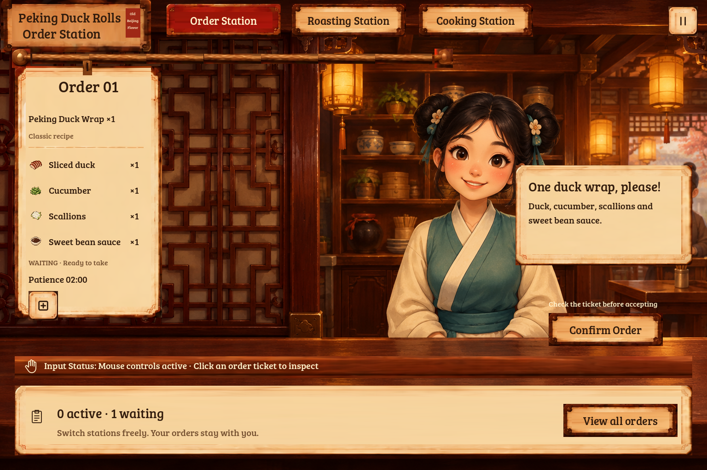
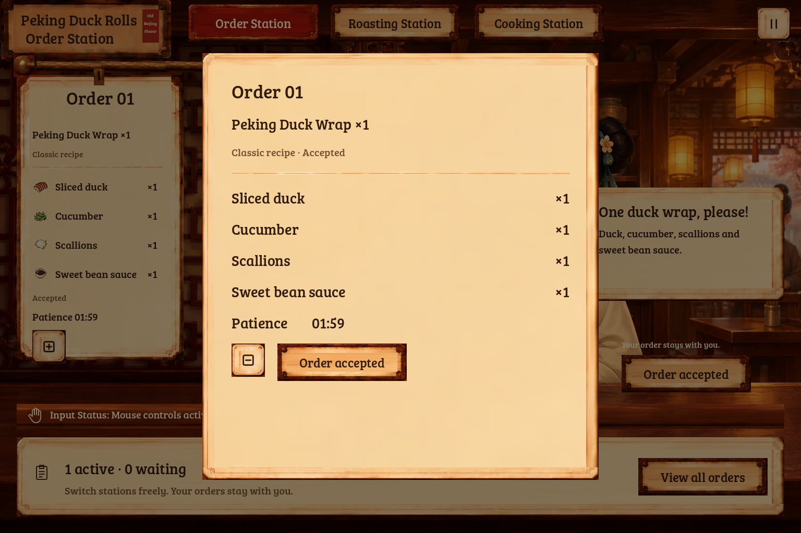
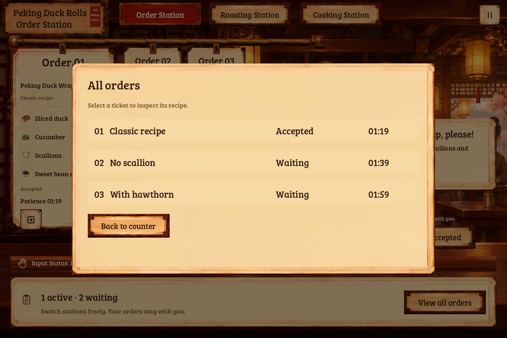
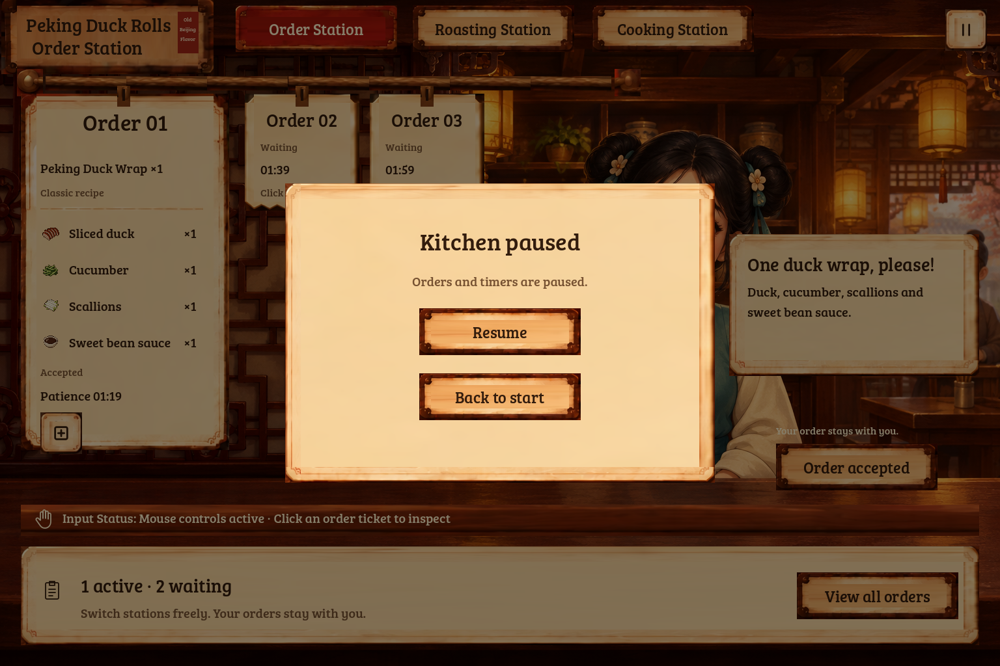
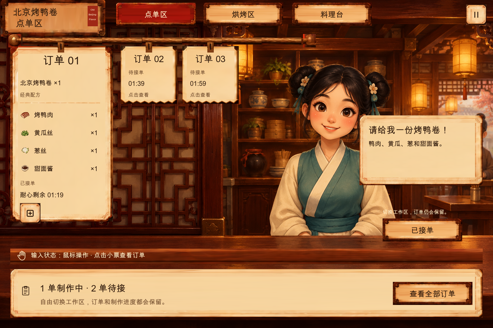

# Approved order counter / 定稿点单台

## Design and scope / 设计与范围

The playable counter follows our [approved Figma screen](https://www.figma.com/design/OUk4C7fCqrzPmnOuzZpYGZ?node-id=217-1122): the green-clothed customer, wooden header, hanging tickets, request panel and bottom order summary. The related source nodes are detail `217:2451`, all orders `217:2525`, and pause `217:2575`.

可玩点单台依据[已定稿的 Figma 页面](https://www.figma.com/design/OUk4C7fCqrzPmnOuzZpYGZ?node-id=217-1122)，保留绿衣顾客、木质导航、悬挂小票、需求面板和底部订单概览。相关节点为详情 `217:2451`、全部订单 `217:2525`、暂停 `217:2575`。

## Implementation / 实现

`game/scenes/shift/approved_order_view.gd` builds editable Godot controls over the original illustration. `game/data/approved_order_layout.json` records source coordinates and texture regions. Frames use nine-slice textures; food icons use the original atlas; English text uses the included Bree Serif font. The complete Figma screenshot is a comparison reference, not a runtime screen with hidden hotspots.

`game/scenes/shift/approved_order_view.gd` 在原插画上组合可编辑的 Godot 控件。`game/data/approved_order_layout.json` 记录来源坐标和纹理区域。边框采用九宫格纹理，食物使用原图集，英文使用随工程附带的 Bree Serif。完整 Figma 截图用于对照，运行画面由独立控件组成。

The order canvas is 1536 × 1024 and scales proportionally. The initial window is 1152 × 768. Existing integrated roasting, preparation and rating views retain their 1440 × 900 layout. New arrivals fill compact tickets without changing the selected order. Requests, recipe rows, status and patience come from `shift_session.gd`; no second order store or clock is created.

点单画布为 1536 × 1024，等比缩放，初始窗口为 1152 × 768。现有烤炉、料理和评分整合页面保留 1440 × 900 布局。新顾客进入紧凑小票，不抢走当前选择；需求、配方、状态和耐心均来自 `shift_session.gd`，没有另建订单数据或计时。

| Interaction / 交互 | Behavior / 行为 |
| --- | --- |
| Confirm / 接单 | Accept the selected ticket once / 仅接收当前订单一次 |
| Expand / 展开 | Show the current recipe and live patience / 查看配方与实时耐心 |
| All orders / 全部订单 | Select another active ticket and inspect it / 选择另一张活动订单并查看 |
| Navigation / 导航 | Switch stations with the same order and food state / 携带同一订单和食物状态切换 |
| Details and list / 详情与列表 | Timers continue; background actions are blocked / 继续计时，阻止底层操作 |
| Pause / 暂停 | Freeze the shift; resume closes the overlay / 冻结营业，继续后关闭弹层 |
| Esc / Esc 键 | Close an order overlay; otherwise toggle pause / 关闭订单弹层，否则切换暂停 |

## Verification / 验证

On 24 November 2026, all eight Godot suites passed on macOS with Godot 4.7.2. The new counter suite checks 20 layout and behavior conditions. Running it with `MAGIC_KITCHEN_SCREENSHOT_DIR` adds eight saved-image checks: initial, accepted, compact queue, expanded ticket, all orders, pause, Chinese and small window. Six Python tests and repository checks are run separately.

2026 年 11 月 24 日，在 macOS、Godot 4.7.2 下八组游戏检查通过。新增点单测试覆盖 20 项布局与行为；设置 `MAGIC_KITCHEN_SCREENSHOT_DIR` 后额外验证八张图片保存，包含初始、已接单、紧凑队列、小票展开、全部订单、暂停、中文与小窗口。Python 六项测试和仓库检查单独执行。

In the actual game window, the assistant clicked acceptance, expanded the ticket, opened all orders, navigated to roasting and back, and paused. Order identity persisted and the details clock continued. This is an assistant-operated check. It does not establish live-camera accuracy, Windows gameplay, a classmate's playtest or tutor approval.

实际游戏窗口中，助手点击完成了接单、展开小票、查看全部订单、切到烤炉并返回、暂停；订单身份保留，详情中的计时继续。这是助手操作检查，不代表真人相机识别、Windows 玩法、同学试玩或教师审查通过。

| Expanded ticket / 小票展开 | All orders / 全部订单 |
| --- | --- |
|  |  |

| Pause / 暂停 | Chinese / 中文 |
| --- | --- |
|  |  |

## Handoff / 对接

The order UI and shared-state wiring are ready for review. Final oven, preparation and serving artwork/animation still belong to their module handoffs. The newer `Serve_and_Score_Demo_v1.1.md` describes a single-order demo; its scope and the existing five-order shift need a team decision before changing the shared flow. Trial recipe, timing and score values remain with the planning owner. Human testing and platform checks remain with the release/testing handoff.

点单 UI 和共享状态接线已可审查。烤炉、料理、交付的最终美术与动画仍按各模块对接。新加入的 `Serve_and_Score_Demo_v1.1.md` 描述单单演示，需要组内确认它与现有五单营业的适用范围后再调整共享流程。配方、时间与评分试运行值由策划确认；真人试玩与平台检查继续按测试发布部分对接。
