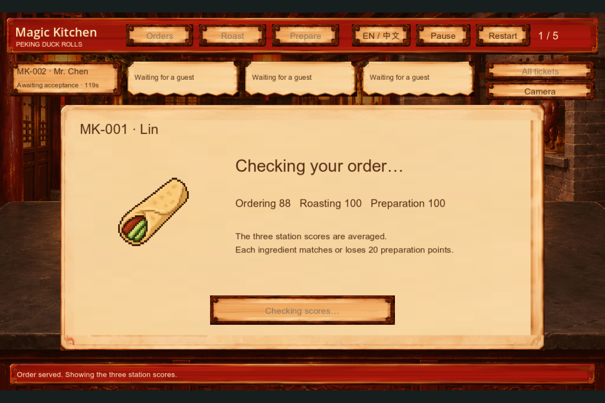
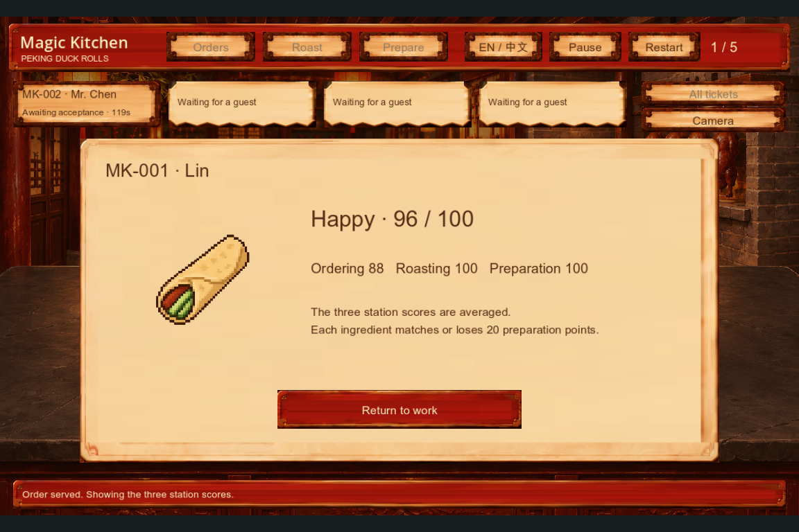

# Serve & score integration / 出餐评分整合

日期：2026-11-25。范围：将已有评分设计与当前共享营业程序逐项对照，记录接口、差异和后续验收；本次只新增整合文档，不修改玩法。

## Contributions and sources / 分工与来源

- **ZHANGYan-Sybil：评分设计。** 本说明沿用她的[交付与结算方案 v1.1](../Serve_and_Score_Demo_v1.1.md)中的三站评分、综合分、反馈档位及单订单演示要求。[设计提交记录](https://github.com/sd5913/forlives--magic_kitchen/commit/fd5c905372abbe8ceb9d89f7175d3fac5b95d30c)保留原作者。
- **JIN Minyi / IceyHikari：程序整合。** 负责把评分要求与共享订单、制作结果、交付状态及返回流程对接。本轮根据本人确认的分工整理现状。
- Codex 辅助核对设计、配置、源码与已有测试，并起草本说明。共同署名对应设计来源与整合贡献，不表示 Sybil 已审阅本说明或批准待确认项。

## Runtime entry points / 程序接入位置

- [shift_session.gd](../../game/scenes/shift/shift_session.gd)：`serve_current()` 计算并保存结果；`can_return()` 控制返回时机；`return_to_work()` 结束评分显示。
- [shift_game.gd](../../game/scenes/shift/shift_game.gd)：料理台完成按钮和 `_build_rating()` 负责触发与显示。
- [shift_rules.json](../../game/data/shift_rules.json)：耐心、火候阈值、火候分、评分等待时长等试运行值。
- [shift_flow tests](../../game/tests/test_shift_flow.gd)：已有评分与流程回归断言。下文只记录源码中存在的检查，不代表本次重新执行过 Godot 测试。

## Scoring contract / 评分约定

| 项目 | Sybil v1.1 设计 | 当前共享程序 |
| --- | --- | --- |
| 点单分 | 剩余耐心秒数 ÷ 120 × 100 | 剩余秒数 ÷ 配置耐心秒数 × 100，限制为 0–100；当前配置为 120 秒 |
| 烤炉分 | 小于 12 秒未熟 40；12 至不足 18 秒适熟 100；18 秒及以上烤焦 0 | 阈值和分数从配置读取，当前与设计数值一致 |
| 料理分 | 五种食材逐项核对，每项正确 20 | 烤鸭片、山楂、葱、黄瓜、甜面酱的“要求包含 / 实际包含”逐项比较，每项匹配 20，包含正确不放的情况 |
| 综合分 | 三项算术平均后四舍五入 | `roundi((wait_score + roast_score + prep_score) / 3.0)` |
| 反馈档位 | ≥90 高分；70–89 中分；<70 低分 | `Happy`、`Satisfied`、`Unhappy` 使用同一分界 |
| 多放食材的额外扣分 | 需要扣分，但扣多少尚未规定 | 对应项失去 20 分；没有另行增加额外扣分，待策划确定 |

例如剩余耐心 90 秒、适熟、五项中四项匹配时：点单 75、烤炉 100、料理 80，综合 `round((75 + 100 + 80) / 3) = 85`，属于中分档。此为公式核对示例，不是玩家实测结果。

## Result and lifecycle / 结果与生命周期

`serve_current()` 当前记录以下字段：

| 字段 | 含义 |
| --- | --- |
| `order_id`、`customer_name`、`order` | 同一订单的身份、顾客及订单快照 |
| `ingredients`、`quality` | 实际成品的食材与火候 |
| `wait_score`、`roast_score`、`prep_score` | 三站独立分数 |
| `total`、`reaction` | 综合分与反馈档位 |

交付需同时满足：可交互、成品阶段为 `ready`、订单为 `ready_to_serve`。成功后订单转为 `served`，结果写入历史并复制到当前评分状态，制作状态清除。再次交付不会重复计分。

评分显示期间，当前共享程序冻结到达、耐心、炉位和制作计时；评分等待本身继续累计。等待达到配置的 3 秒且未暂停时，返回按钮才可用。

## Differences still to resolve / 仍待对齐

- **演示范围：** v1.1 定义单订单演示；共享程序仍是五单营业与汇总。需决定增加独立单订单入口，还是调整共享入口；本次没有更改订单数量。
- **返回位置：** 设计希望返回触发完成按钮的工作区，可先固定料理台 / 测试入口；共享程序当前固定返回点单台。
- **展示顺序（11 月 26 日已补）：** 按配置三秒分四段，依次揭示点单、烤炉、料理，最后显示综合分和档位并开放返回。分数始终读取本次交付结果，不重新计分；人物观察／表情仍待美术接入。
- **美术与文字：** 顾客观察 / 高中低分表情、铜钱表现及 v1.1 双语评价台词，尚未按完整设计接入当前共享评分页。铜钱仍是视觉奖励要求，不新增经济系统。
- **额外扣分：** 不自行编造多放食材的额外扣分数值，待设计与整合双方确认。

## Acceptance checklist / 后续验收

以下项目等待实际检查后再勾选；不是本次已通过的运行测试：

- [ ] 核对 11.999 / 12 / 17.999 / 18 秒火候边界及对应分数。
- [ ] 用完美配方、漏放与多放配方，核对逐项料理分和综合分。
- [ ] 验证未卷好不能交付、同一订单不能重复计分。
- [ ] 验证评分期间厨房计时冻结，3 秒前不能返回，暂停时不能返回。
- [ ] 双方确认演示范围、返回位置、额外扣分及最终视觉反馈。
- [ ] 在确定的平台运行相关自动检查和完整流程，另行记录同学试玩观察。

本次验证范围：阅读并交叉核对设计稿、规则配置、上述两个脚本和现有测试断言；检查文档相对链接及公式示例。没有新增玩家、教师或 Sybil 审阅结论。

相关入口：[整合交接](INTEGRATION-HANDOFF.md) · [共享营业流程](SHIFT-FLOW.md) · [技术目录](README.md)。

## 26 November feedback polish / 11 月 26 日反馈优化

评分展示已在原面板中接通，不更改公式、档位、三秒总时长、五单范围或返回点单规则。当前三秒下，0.75 秒揭示点单分、1.5 秒揭示烤炉分、2.25 秒揭示料理分、3 秒显示总分并开放返回。暂停仍冻结展示时间。中文档位也已使用中文文字。

本轮 macOS／Godot 4.7.2 自动检查覆盖分数不提前泄露、顺序、提前返回禁用、最终返回和结果不变。新增反馈检查 17 项；含三张实际渲染截图共 20 项，零失败。全部十组游戏检查通过。这不表示已完成最终结算美术或真人试玩。

| 展示中 | 结果展示完成 |
| --- | --- |
|  |  |
